# AI 工程工作流技能套件（ai-engineering-workflow-skills v1.0）教育訓練與情境實戰手冊

本手冊為 `ai-engineering-workflow-skills`（v1.0 四站七技能 Jira 核心小團隊工程工作流）之完整教育訓練教材與實戰操作指南。全書採用**真實使用情境驅動（Scenario-Driven Training）**編排，結合視覺化架構圖、終端機與 Jira 雙視窗實況對照圖、CLI 參數規格表與標準操作步驟，協助工程團隊從零完成專案導入、規格定義、任務拆解、AI 編碼、三軸審查、平行測試、缺陷修復閉環與正式發佈結案。

---

## 1. 文件目的、適用角色與訓練導覽

### 1.1 為什麼需要「四站七技能 Jira 核心工作流」？

在中小型工程團隊（1 至 10 人）導入 AI 輔助開發時，傳統多階段文件工作流常面臨三大痛點：

1. **Git 儲存庫充斥一次性流程文件（Repo Bloat）**：每個功能都在 `docs/requirements/`、`docs/ux/`、`docs/design/`、`docs/qa/` 留下大量 Markdown 檔案，功能上線後無人維護，不僅造成版本控制噪音，更污染 AI 代理的上下文視窗（Context Window）。
2. **一人兼多職卻被迫走繁瑣交接儀式（Handoff Ceremony Fatigue）**：小團隊常由同一位成員兼任多個角色（例如 PM 兼 Release Manager，或 Tech Lead 兼 Developer 與 Reviewer），若機械式要求每站人工簽核與自我通知，會嚴重拖慢交付節奏。
3. **細枝末節追問耗盡人類審查精力（Review Fatigue）**：AI 若將常規分頁筆數、標準 HTTP 錯誤碼、Loading 骨架屏或測試執行方式逐題詢問人類，會導致關鍵架構風險與業務矛盾反而被忽略。

為解決上述問題，`ai-engineering-workflow-skills` v1.0 確立了四大核心設計支柱：

- **第一性原理資產邊界（First-Principles Asset Boundary）**：單一功能的生命週期資產永久保存於 **Jira**（`User Story`、`Sub-task`、`Bug` 與結構化評論），本地僅在開發期間維護 Git 忽略的暫存狀態檔 `.ai-workflow/active/<JIRA-KEY>.json`，並在發佈結案時自動刪除；Git 儲存庫僅保留全系統常駐活資產（`AGENTS.md`、`docs/shared/engineering-standards.md`、選用之 `glossary.md` 與 `adr/`）。
- **四站七技能精煉架構（4-Station, 7-Skill Architecture）**：將傳統十餘個零碎步驟收斂為 **Init 初始化**、**Router 導航員**及 **Station 1 至 Station 4** 共 7 個高內聚技能，且支援開發（`team-dev`）與測試規劃（`team-qa` `plan` 模式）雙軌平行推進。
- **多角色感知與智慧交接（Multi-Role Smart Handoff）**：透過 `.ai-workflow/team-config.json` 自動識別上、下一站是否為同一人。同人兼任時自動整併（`auto-consolidated` 零通知噪音）；跨人交接時自動執行 Jira 狀態轉換、Assignee 指派與 `@mention` 評論推播。
- **內嵌「抓大放小」審查原則（Inline Focus-on-Material-Risks）**：常規工程與 UI 細節由 AI 依專案標準自動拍板並列入**AI 預設細節清單**（`auto_decisions`）；僅在遇到不可逆架構/資料風險、業務規則矛盾或重大成本取捨時，才向人類提出**最多 3 題**附帶建議方案的關鍵問題（`material_decisions`）。

### 1.2 六大核心角色職責與建議訓練路徑

本工作流支援標準六大角色與選用之獨立審查員角色。團隊成員可依自身職責按表索驥閱讀對應情境章節：

| 角色識別碼 (`roles.*`) | 角色中文名稱 | 核心職責與關注焦點 | 必讀訓練情境章節 | 常駐操作技能 |
| :--- | :--- | :--- | :--- | :--- |
| `pm` | **產品經理 (PM Owner)** | 界定功能範圍（In/Out-of-Scope）、審核可測試驗收條件 `AC-*`、拍板最多 3 題關鍵產品決策 | 第 2 章、第 3 章（情境 0）、第 4 章（情境 1）、第 10 章（情境 7） | `team-init`, `team-spec`, `team-next-step` |
| `tech_lead` | **技術負責人 (Tech Lead)** | 維護全系統工程標準 `docs/shared/engineering-standards.md` 與 `ADR-*`，把關變更面與技術設計 | 第 2 章、第 3 章（情境 0）、第 4 章（情境 1）、第 6 章（情境 3） | `team-init`, `team-spec`, `team-review` |
| `developer` | **開發工程師 (Developer)** | 將規格拆解為垂直切片子任務 `TASK-001..N`、以極簡上下文撰寫程式與自動化測試、修復 `BUG-*` 並執行 `complete-task` 打卡 | 第 5 章（情境 2A/2B）、第 8 章（情境 5）、第 10 章（情境 7） | `team-dev` (`plan` / `implement`), `team-next-step` |
| `reviewer` / `independent_reviewer` | **程式碼審查員 (Reviewer)** | 執行三軸程式碼審查（AC 符合度、設計符合度、工程標準與資安），決定放行至 QA 或退回重修 | 第 6 章（情境 3）、第 8 章（情境 5） | `team-review` |
| `qa` | **品質工程師 (QA Owner)** | 平行規劃 100% 覆蓋 `AC-*` 之測試案例 `TC-001..N`、匯入 JUnit XML/JSON 與手動測試結果、失敗時自動開立關聯 Jira `Bug` 單 | 第 7 章（情境 4A/4B）、第 8 章（情境 5） | `team-qa` (`plan` / `verify`) |
| `release_manager` | **發佈管理員 (Release Manager)** | 執行五大發佈閘門與 Commit SHA 對齊檢查、發佈最終摘要、將 Jira Story 轉為 `Done` 並清除本地暫存鷹架 | 第 9 章（情境 6）、第 11 章（情境 8） | `team-release`, `team-next-step` |

### 1.3 三分鐘極速上手卡（零記憶門檻 Cheat Sheet）

**重要觀念：你完全不需要背誦任何 `jira_sync.py` CLI 指令或旗標！**
本手冊後半部列出的 CLI 語法與參數表，是供 AI 代理在背景自動組裝執行與架構師查閱的底層規格。在日常開發中，**所有 CLI 指令皆由 AI 在背景自動執行（Zero-CLI Burden）**，甚至當你一人兼任前後兩站角色（`same_person: true`）時，AI 會自動連貫推進。你只需要記住唯一萬用導航指令 **`$team-next-step`**，或直接對 AI 說出下表中的自然語言白話指令：

| 階段與情境 | 你只需要對 AI 說這 1 句話（人類零 CLI 負擔） | AI 在背景自動幫你完成的事（無須手敲指令） |
| :--- | :--- | :--- |
| **隨時迷路 / 接手工作** | **「執行 `$team-next-step`（或：下一步要做什麼？）」** | 自動檢查本地與遠端 Jira（若換電腦或開新 Git Worktree 缺少本地檔案，自動從 Jira 無損回填 `.ai-workflow/active/<KEY>.json`），並給出唯一具體行動。 |
| **初次設定專案** | **「請用 `$team-init` 初始化專案，代號 `TEAM`，PM 與審查是 Alice，開發是 Bob，QA 是 Carol。」** | 自動產生 `.ai-workflow/team-config.json`、安裝統一短指令 `.ai-workflow/bin/jira_sync.py`、設定 `.gitignore`，並從 `AGENTS.md` 萃取去重工程標準。 |
| **Station 1 定規格** | **「請用 `$team-spec` 規劃 `PROJ-101` 訂單 CSV 匯出，確認沒問題請同步 Jira。」** | 一回合產出可測試 `AC-001..N`、條件式 UI/API 設計與**AI 預設細節清單**（最多只問 3 題關鍵問題），確認後自動同步 Jira 並交接開發。 |
| **Station 2 寫程式** | **「請用 `$team-dev` 實作 `PROJ-101` 並跑過測試打卡。」** | 自動拆解子任務（若為小型單任務功能則啟動 **Dev Fast-Track** 免拆單直接打卡），寫完程式與測試後自動從 Git 偵測 `--commit` 與 `--files` 完成打卡。 |
| **Station 3a 審程式** | **「請用 `$team-review` 審查 `PROJ-101` 並交接給 QA。」** | 自動比對 Git Diff 與三軸標準；若通過則轉為 `In QA` 並 `@mention` 通知 QA；若退回重修則自動建立 `REV-001` 追蹤項交回開發修復。 |
| **Station 3b 跑測試** | **「請用 `$team-qa` 驗證 `PROJ-101`。」** | 自動執行測試（支援 **QA Fast-Track** 直接由 `AC-*` 自動衍生 `TC-*` 並以 `--all-pass` 一鍵通過）；若有失敗則自動開立 Jira `Bug` 單退回開發。 |
| **Station 4 上線結案** | **「請用 `$team-release` 將 `PROJ-101` 結案發佈。」** | 自動帶入候選 Commit 與預設版本號 `v1.0.0`，驗證五大發佈閘門後將 Jira Story 轉為 `Done`，並自動清除本地 `.ai-workflow/active/<KEY>.json`。 |

---

## 2. 全系統架構總覽與三層源碼功能盤點對帳表

### 2.1 四站七技能架構與第一性原理資產邊界

在進入各使用情境前，請先透過全景架構圖建立對「四站七技能流程」與「Jira vs Git 雙資產邊界」的整體認知：

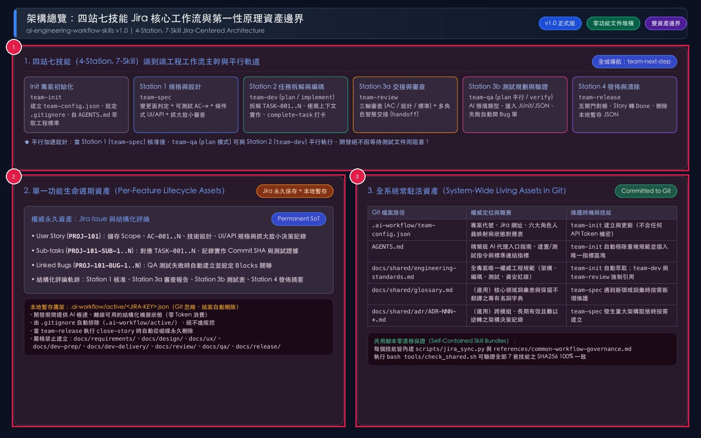
*圖 2-1：四站七技能全景架構與第一性原理資產邊界圖。用途：說明 7 個技能在 4 個工作站中的串聯與平行關係，以及單一功能資產與全系統資產的嚴格存放邊界。視覺焦點：請依序查看標註序號 ① 頂部四站七技能主幹流程與 `team-qa` 平行軌道；② 左下角單一功能生命週期資產（Jira 永久保存 + `.ai-workflow/active/<JIRA-KEY>.json` 本地暫存）；③ 右下角全系統常駐活資產（Git 版控之 `team-config.json`、`AGENTS.md`、`engineering-standards.md`、`glossary.md`、`adr/`）。狀態變化：功能開發期間狀態讀寫於本地 Active JSON 與 Jira，結案時本地 Active JSON 自動刪除，實現 Git 儲存庫零流程文件堆積。*

以下為全系統 7 個技能模組的工作站定位、執行模式與底層 CLI 動作總表：

| 工作站 (Station) | 技能名稱 (Skill) | 執行模式 (Modes) | 負責角色 | 底層 `jira_sync.py` 子命令 | 核心產出與狀態變更 |
| :--- | :--- | :--- | :--- | :--- | :--- |
| **Init 初始化** | `team-init` | 無（單一模式） | `tech_lead` / `pm` | `init` | 建立 `.ai-workflow/team-config.json`、更新 `.gitignore`、自 `AGENTS.md` 萃取去重 `docs/shared/engineering-standards.md` |
| **Router 導航員** | `team-next-step` | 無（唯讀模式） | 全體成員 | `status` | 唯讀檢查設定檔、Active JSON 與遠端 Jira，依 11 級優先序推薦唯一具體下一步行動 |
| **Station 1 規格設計** | `team-spec` | 無（單一模式） | `pm` (+ `tech_lead`) | `sync-story` | 產出 Scope、`AC-001..N`、條件式 UI/API 規格與抓大放小決策，同步至 Jira Story 並設為 `approved` |
| **Station 2 任務與編碼** | `team-dev` | `plan` / `implement` | `developer` | `create-subtasks` / `complete-task` | `plan` 拆解 `TASK-001..N` 並建立 Jira `Sub-task`；`implement` 編碼測試後打卡完成並更新 `candidate_commit` |
| **Station 3a 審查交接** | `team-review` | 無（單一模式） | `reviewer` / `independent_reviewer` | `handoff` | 合併開發交接與三軸審查，更新 `review.status` 與 `reviewed_commit`，並依角色配置通知 QA 或退回開發 |
| **Station 3b 測試驗證** | `team-qa` | `plan` / `verify` | `qa` | `record-qa` / `create-bug` | `plan` 平行產生 AI 預填類型之 `TC-001..N`；`verify` 匯入結果，全過則交接發佈，失敗則開立 Jira `Bug` 退回開發 |
| **Station 4 發佈清除** | `team-release` | 無（單一模式） | `release_manager` | `close-story` | 驗證五大發佈閘門與 Commit SHA 對齊，發佈摘要評論，將 Jira Story 轉為 `Done` 並刪除本地 Active JSON |

### 2.2 Jira 狀態轉換機與多角色智慧交接機制

小團隊最常見的組織形態是「一人身兼多職」。本套件內建 `is_same_person()` 與 `execute_role_handoff()` 智慧交接引擎，自動根據 `.ai-workflow/team-config.json` 的人員映射切換交接行為：

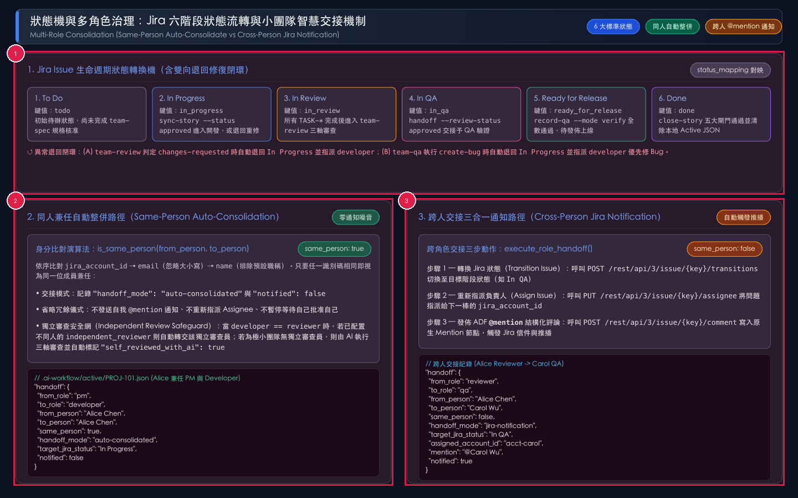
*圖 2-2：Jira 六階段狀態轉換機與多角色智慧交接決策圖。用途：展示 Jira Story 從 `To Do` 到 `Done` 的正向流轉、異常退回閉環，以及同人兼任與跨人交接的行為差異。視覺焦點：請依序查看標註序號 ① 頂部六大標準 Jira 狀態（`To Do` → `In Progress` → `In Review` → `In QA` → `Ready for Release` → `Done`）與退回迴圈；② 左下角同人兼任自動整併路徑（`handoff_mode: "auto-consolidated"`）；③ 右下角跨人交接三合一通知路徑（`handoff_mode: "jira-notification"`）。狀態變化：當前後站為同一人時不發送自我 `@mention` 且不重設 Assignee；當前後站為不同人時自動轉狀態、改指派並發送含 `@mention` 之 ADF 評論。*

多角色智慧交接與獨立審查安全網之核心規則如下：

1. **同人身分判定順序（`is_same_person`）**：
   - 第一優先比對雙方的 `jira_account_id`（若雙方皆非空且相等，即判定為同一人）。
   - 第二優先比對雙方的 `email`（忽略大小寫，若雙方皆非空且相等，即判定為同一人）。
   - 第三優先比對雙方的 `name`（忽略大小寫，且排除預設職稱如 `PM Owner`、`Developer` 等，若相等即判定為同一人）。
2. **同人自動整併模式（`auto-consolidated`）**：
   - 當 `from_role` 與 `to_role` 指向同一位成員時，系統自動更新 Jira 狀態並寫入交接評論，但設定 `"notified": false`，**不發送自我 `@mention`、不打斷工作流等待自己簽核自己**，並立即提示可銜接執行下一站技能。
3. **跨人三合一通知模式（`jira-notification`）**：
   - 當 `from_role` 與 `to_role` 為不同成員時，系統自動執行三步驟：(1) 轉換 Jira Issue 至目標狀態；(2) 將 Issue 重新指派（Assign）給下一站負責人的 `jira_account_id`；(3) 在 Jira 評論開頭插入原生 ADF Mention 節點（`@{name}` **請接手下一階段工作：**），觸發 Jira 原生信件與通知推播。
4. **獨立審查安全網（`resolve_effective_reviewer`）**：
   - 在 Station 3a（`team-review`），若 `developer` 與 `reviewer` 為同一人，系統會優先檢查 `team-config.json` 是否配置了屬於不同人的 `independent_reviewer`；若有，自動將審查權轉交給 `independent_reviewer`。
   - 若為極小團隊（或一人團隊）未配置獨立審查員，則允許由 AI 執行三軸嚴格審查，並強制在 Active JSON 與 Jira 評論中寫入 `"self_reviewed_with_ai": true` 透明稽核標記。

### 2.3 三層源碼功能盤點對帳表（3-Layer Coverage Matrix）

為確保本訓練手冊 **100% 涵蓋儲存庫內所有技能、模式、CLI 子命令、旗標與治理規則（零遺漏）**，動筆前已完成以下三層源碼盤點對帳：

| 層級與源碼路徑 | 功能名稱（對齊源碼定義） | 次級介面 / 模式 / 子命令 / 閘門 | 適用角色 | 對應章節與視覺圖表 |
| :--- | :--- | :--- | :--- | :--- |
| **L1/L3** `common-workflow-governance.md` | 四站七技能共同治理契約 | 第一性原理資產邊界、多角色感知、抓大放小、雙模式同步、語言與證據鐵律 | 全體角色 | 2.1 - 2.3（圖 2-1：`01-architecture-asset-boundary.png`、圖 2-2：`02-state-machine-and-roles.png`） |
| **L1/L2** `skills/team-init/SKILL.md` | 專案與角色初始化 (`team-init`) | `jira_sync.py init`、`team-config.json`、`.gitignore`、`AGENTS.md` 規範萃取與指標去重 | `tech_lead` / `pm` | 第 3 章 情境 0（圖 3-1：`03-scenario0-team-init.png`） |
| **L1/L2** `skills/team-spec/SKILL.md` | 一體化規格、UX 與技術設計 (`team-spec`) | `jira_sync.py sync-story`、大小需求雙軌制（單趟 `approved` vs 多輪 `draft` 深挖）、6 大 AC 完整性檢查維度、抓大放小 | `pm` / `tech_lead` | 第 4 章 情境 1（圖 4-1：`04-scenario1-team-spec.png`） |
| **L1/L2** `skills/team-dev/SKILL.md` (`plan`) | 開發任務垂直拆解 (`team-dev` `plan` 模式) | `jira_sync.py create-subtasks`、`TASK-001..N`、Jira `Sub-task`、DFS 循環依賴檢查 | `developer` | 5.1 - 5.2 情境 2A（圖 5-1：`05-scenario2-team-dev-plan.png`） |
| **L1/L2** `skills/team-dev/SKILL.md` (`implement`) | 極簡上下文編碼與打卡 (`team-dev` `implement` 模式) | `jira_sync.py complete-task`、優先序（Open Bug > Pending Task > Review Finding）、Dev Fast-Track 複雜度守衛（限 `<= 3` AC 且中低風險） | `developer` | 5.3 - 5.4 情境 2B（圖 5-2：`06-scenario2-team-dev-implement.png`） |
| **L1/L2** `skills/team-review/SKILL.md` | 合併開發交接與三軸審查 (`team-review`) | `jira_sync.py handoff`、三軸審查（AC 逐條覆蓋 / 設計 / 標準）、QA 外部測試工具提示、`AGENTS.md` 自動回退、AI 自審透明標記 | `reviewer`（含獨立審查員） | 第 6 章 情境 3（圖 6-1：`07-scenario3-team-review.png`） |
| **L1/L2** `skills/team-qa/SKILL.md` (`plan`) | 平行測試案例規劃 (`team-qa` `plan` 模式) | `jira_sync.py record-qa --mode plan`、100% AC 覆蓋強制防呆檢查、AI 預填三層執行類型（`automated` / `external` / `manual`） | `qa` | 7.1、7.3 情境 4A（圖 7-1：`08-scenario4-team-qa-plan.png`） |
| **L1/L2** `skills/team-qa/SKILL.md` (`verify`) | 三層混合測試驗證 (`team-qa` `verify` 模式) | `jira_sync.py record-qa --mode verify`、`--all-pass` 防假通過守衛（僅通過 `automated`）、`--junit-xml`、`--results-json`、`--result` | `qa` | 7.2、7.3 情境 4B（圖 7-2：`09-scenario4-team-qa-verify.png`） |
| **L1/L2** `skills/team-qa/SKILL.md` + `team-dev` | 測試失敗自動開 Bug 與閉環重測 | `jira_sync.py create-bug`、Jira `Bug` + `Blocks` 連結、退回 `developer`、`complete-task` 關單、Commit 漂移重審重驗 | `qa` / `developer` / `reviewer` | 第 8 章 情境 5（圖 8-1：`10-scenario5-bug-loop.png`） |
| **L1/L2** `skills/team-release/SKILL.md` | 發佈閘門對帳與暫存清除 (`team-release`) | `jira_sync.py close-story`、五大決定性發佈閘門、Story 轉 `Done`、自動刪除 `.ai-workflow/active/<KEY>.json` | `release_manager` | 第 9 章 情境 6（圖 9-1：`11-scenario6-team-release.png`） |
| **L1/L2** `skills/team-next-step/SKILL.md` | 唯讀工作流導航員 (`team-next-step`) | `jira_sync.py status`、11 級優先序路由表、多 Story 歧義防猜測、`--fetch-remote`、五段式標準回覆 | 全體角色 | 第 10 章 情境 7（圖 10-1：`12-scenario7-and-8-router-and-modes.png`） |
| **L3** `scripts/jira_sync.py` + `tools/*` | 雙模式同步引擎、安全防護與自檢工具 | Live Jira REST API v3 三大環境變數、Offline 模式 (`--offline`)、`check_shared.sh`、`test_workflow.py` | 維運 / 全體角色 | 第 11 - 12 章 情境 8（圖 10-1：`12-scenario7-and-8-router-and-modes.png`） |

---

## 3. 情境 0：專案初次導入與團隊角色初始化（`team-init`）

### 3.1 觸發時機與情境背景

當你的團隊準備在一個全新或既有的程式碼儲存庫（Repository）導入 `ai-engineering-workflow-skills`，或者當成員變動需要調整角色對應、抑或 `team-next-step` 提示缺少 `.ai-workflow/team-config.json` 時，請執行 **`team-init`**。

在此訓練情境中，假設我們的小型團隊共有 3 位成員負責 `TEAM` 專案：
- **Alice Chen**：身兼 **產品經理 (`pm`)**、**技術負責人 (`tech_lead`)**、**程式碼審查員 (`reviewer`)** 與 **發佈管理員 (`release_manager`)** 四職。
- **Bob Lin**：擔任專職 **開發工程師 (`developer`)**。
- **Carol Wu**：擔任專職 **品質工程師 (`qa`)**。

同時，專案根目錄原本已有一份 `AGENTS.md`，裡面混雜了建置指令與長篇的編碼、資安規範。我們希望透過 `team-init` 一次完成角色配置、`.gitignore` 設定，並將工程規範萃取至唯一權威來源 `docs/shared/engineering-standards.md`。

### 3.2 操作步驟與視覺化實況詳解

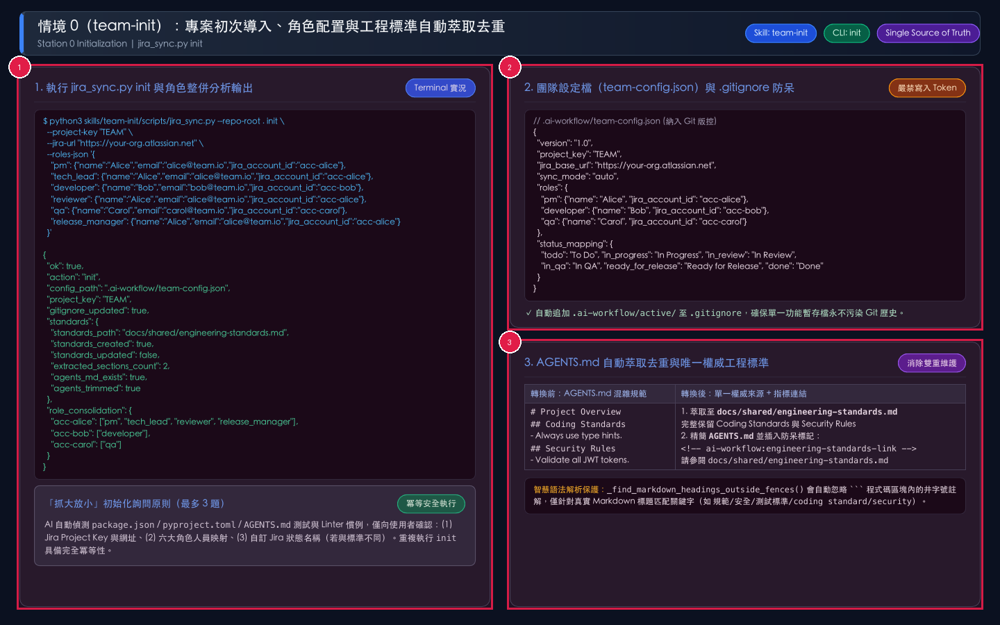
*圖 3-1：情境 0 執行 `team-init`（`jira_sync.py init`）之終端機輸出與檔案收斂前後對照圖。用途：示範如何以單一指令完成團隊多角色映射設定、`.gitignore` 規則注入，以及 `AGENTS.md` 與 `docs/shared/engineering-standards.md` 的自動萃取去重。視覺焦點：請依序查看標註序號 ① 左側終端機執行 `jira_sync.py init` 指令與輸出的 `role_consolidation` 角色整併表；② 右上角生成的 `.ai-workflow/team-config.json` 與 `.gitignore` 自動加入 `.ai-workflow/active/`；③ 右下角 `AGENTS.md` 自動抽離重複規範並替換為唯一指標區塊。狀態變化：初始化前 `initialized: false` 且規範散落於 `AGENTS.md`；初始化後產生受版控之 `team-config.json` 與 `engineering-standards.md`，且重複執行 `init` 保證完全冪等。*

請依序執行以下三步驟完成專案導入：

1. **步驟一：向 AI 代理觸發 `$team-init`，由 AI 主動詢問確認 4 大設定項目**
   - 在對話中輸入 `$team-init`（或「請幫我初始化本專案」）。
   - AI 會先執行 `jira_sync.py init --inspect` 並自動掃描 `package.json`、`pyproject.toml`、`go.mod`、`Makefile` 與 `AGENTS.md` 偵測技術棧，接著**主動停下來向您詢問確認**：
     1. **專案 Jira URL 與 Project Key**（例如 `https://your-org.atlassian.net`、代號 `TEAM`）
     2. **預設 Jira 認證帳號（Email）與 API Token**（作為未單獨設定角色專屬 Token 時的 fallback）
     3. **六大角色定義、對應人員與各角色專屬 API Token**（`pm`、`tech_lead`、`developer`、`reviewer`、`qa`、`release_manager` 的姓名、Email 與該成員的 Jira API Token；設定各角色專屬 Token 後，各站點評論會直接以該角色本人的 Jira 帳號頭像發出，並自動呼叫 `/rest/api/3/myself` 綁定 `jira_account_id`；所有 Token 皆只會寫入受 `.gitignore` 保護的 `.ai-workflow/credentials.json`，權限 `0600`）
     4. **Jira 狀態與單據類型映射**（是否沿用預設值或自訂）
2. **步驟二：確認回覆後，執行決定性初始化腳本 `jira_sync.py init`**
   - AI 代理根據您的回覆（或開發者透過 `init --interactive` 互動模式）於專案根目錄執行以下指令：

```bash
python3 skills/team-init/scripts/jira_sync.py \
  --repo-root . init \
  --project-key "TEAM" \
  --jira-url "https://your-org.atlassian.net" \
  --jira-email "alice@team.io" \
  --jira-token "<DEFAULT_JIRA_API_TOKEN>" \
  --roles-json '{
    "pm": {
      "name": "Alice",
      "email": "alice@team.io"
    },
    "tech_lead": {
      "name": "Alice",
      "email": "alice@team.io"
    },
    "developer": {
      "name": "Bob",
      "email": "bob@team.io"
    },
    "reviewer": {
      "name": "Alice",
      "email": "alice@team.io"
    },
    "qa": {
      "name": "Carol",
      "email": "carol@team.io"
    },
    "release_manager": {
      "name": "Alice",
      "email": "alice@team.io"
    }
  }' \
  --role-tokens-json '{
    "developer": "<BOB_JIRA_API_TOKEN>",
    "qa": "<CAROL_JIRA_API_TOKEN>"
  }'
```

3. **步驟三：檢視產出檔案與提交 Git 版控**
   - 確認 `.ai-workflow/team-config.json`、本地受保護憑證 `.ai-workflow/credentials.json`（已被 `.gitignore` 排除，絕不進版控）、統一短指令入口 `.ai-workflow/bin/jira_sync.py`（自動設為可執行 `0755`）、`.gitignore`、`docs/shared/engineering-standards.md` 與精簡後的 `AGENTS.md` 皆已正確生成，即可將受版控檔案提交至 Git。

### 3.3 `jira_sync.py init` 參數與產出檔案規格表

| 類別 | 參數或檔案名稱 | 必填 / 預設值 | 功能說明與輸入規範 | 狀態影響與防呆機制 |
| :--- | :--- | :--- | :--- | :--- |
| **CLI 子指令** | `auth`（或 `init --auth-only`） | 協作者專用 | 新成員 `git clone` 已初始化專案後，選擇負責角色（`--role qa` 或 `--role reviewer,qa`）並綁定個人 `--jira-email`、`--jira-token` 與選填 `--qase-token` | 驗證 `/rest/api/3/myself` 後，將 Token 寫入本機 `.ai-workflow/credentials.json`（`0600`），並自動將認領角色之 `name`、`email`、`jira_account_id` 補寫回 `team-config.json`（若角色原本已吻合則不重複改動） |
| **CLI 旗標** | `--role` / `--name` | 選填（支援逗號分隔） | 初始化者或協作者可僅認領自己負責的角色（如 `--role pm,tech_lead,developer`），未指定之角色保留於 `unclaimed_roles` 供後續成員認領 | 若未傳 `--name`，連線模式下自動由 Jira `/rest/api/3/myself` 帶入 `displayName` 與 `accountId` |
| **CLI 旗標** | `--inspect` | 選填（布林旗標） | 唯讀檢查目前專案初始化與憑證狀態，回傳尚未確認之 `questions_to_ask` | 不修改任何檔案；供 AI 在執行 `init` 前先向使用者詢問確認 |
| **CLI 旗標** | `-i` / `--interactive` | 選填（布林旗標） | 終端機互動式問答模式，逐步詢問 URL、Project Key、帳號、Token 與六大角色 | 適合人類開發者直接於終端機手動執行初始化 |
| **CLI 旗標** | `--project-key` | 選填（預設 `PROJ`） | 設定 Jira 專案代號（自動轉為大寫，如 `TEAM`） | 寫入 `team-config.json` 之 `project_key` |
| **CLI 旗標** | `--jira-url` | 選填（預設空字串） | 設定 Jira Cloud 主機網址（如 `https://org.atlassian.net`） | 僅允許 `http` 或 `https` 協定；自動移除結尾斜線 |
| **CLI 旗標** | `--jira-email` | 選填 | 設定 Jira 認證登入信箱（`JIRA_EMAIL`） | 寫入受 `.gitignore` 保護之 `.ai-workflow/credentials.json` |
| **CLI 旗標** | `--jira-token` | 選填 | 設定 Jira API Token（`JIRA_API_TOKEN`） | 寫入 `.ai-workflow/credentials.json`（權限 `0600`），**嚴禁寫入 `team-config.json`** |
| **CLI 旗標** | `--roles-json` | 選填 | JSON 字串或檔案路徑，定義 `pm`、`tech_lead`、`developer`、`reviewer`、`qa`、`release_manager` 及選用之 `independent_reviewer` | 支援傳入 `{name, email, jira_account_id, api_token}`；內嵌之 `api_token` 會自動剝離轉存至 `credentials.json`，並自動呼叫 Jira API 解析補齊 `jira_account_id` |
| **CLI 旗標** | `--role-tokens-json` | 選填 | JSON 字串或檔案路徑，設定各角色專屬 Jira API Token（如 `{"qa": "..."}`） | 寫入 `.ai-workflow/credentials.json` 之 `role_credentials`，使各站點直接以該角色本人之 Jira 帳號發送評論與流轉狀態 |
| **CLI 旗標** | `--status-mapping-json` | 選填 | JSON 字串或檔案路徑，自訂六大狀態對應之 Jira 狀態名稱 | 覆寫 `todo`、`in_progress`、`in_review`、`in_qa`、`ready_for_release`、`done` 映射 |
| **CLI 旗標** | `--issue-type-mapping-json` | 選填 | JSON 字串或檔案路徑，自訂 `story`、`subtask`、`bug` 對應之 Jira 單據類型 | 覆寫 `team-config.json` 之 `issue_type_mapping` |
| **CLI 旗標** | `--agents-md` | 選填（預設 `AGENTS.md`） | 指定專案內 AI 代理入口文件之相對路徑 | 自動解析 Markdown 標題（忽略程式碼區塊內之 `#` 註解） |
| **CLI 旗標** | `--standards-md` | 選填（預設 `docs/shared/engineering-standards.md`） | 指定全專案唯一權威工程規範之輸出路徑 | 若 `AGENTS.md` 含規範段落則自動萃取合併，否則由預設範本建立 |
| **產出檔案** | `.ai-workflow/team-config.json` | 自動建立（進 Git） | 儲存專案代號、Jira 網址、角色人員映射、狀態表與 `issue_type_mapping` | **嚴禁寫入 `JIRA_API_TOKEN` 或密碼** |
| **產出檔案** | `.ai-workflow/credentials.json` | 自動建立（**不進 Git**） | 儲存本地 Jira 認證信箱與 API Token（權限 `0600`），供後續各站自動載入連線 | 自動寫入 `.gitignore`，防止憑證外洩 |
| **產出檔案** | `.ai-workflow/bin/jira_sync.py` | 自動建立（進 Git） | 業務專案本地統一 CLI 入口（權限 `0755`） | 解決全域安裝 Skill 時業務專案無 `skills/` 目錄之路徑問題 |
| **產出檔案** | `.gitignore` | 自動更新（進 Git） | 自動確保包含 `.ai-workflow/active/`、`.ai-workflow/credentials.json` 與 `.ai-workflow/.env` | 具備冪等性，重複執行 `init` 不會重複插入多行 |

---

## 4. 情境 1：新功能從 User Story 到定規格與「抓大放小」審查（`team-spec`）

### 4.1 觸發時機與情境背景

當專案已完成初始化，產品經理（PM）或技術負責人準備啟動一項新功能、變更請求或架構調整（例如 Jira Story `PROJ-101`：**新增訂單 CSV 匯出功能**）時，進入 **Station 1：`team-spec`**。

在舊版工作流中，團隊必須依序執行需求分析、UX 設計、技術架構設計與文件審查四個獨立步驟；而在 `team-spec` 中，AI 採用**大小需求雙軌制（Scale-Aware Dual Track）**與 **6 大 AC 完整性檢查表**，兼顧小需求效率與大需求完整性：
1. **變更面分析（Change Surface Analysis）**：依據源碼自動判定 `has_ui`、`has_api`、`has_data`。
2. **可測試驗收條件（`AC-001..N`）與 6 大完整性維度檢查**：消除「快速」、「友善」等模糊形容詞，並強制核對六大維度：(1) 核心主流程 Happy Path、(2) 角色權限與租戶隔離 AuthZ、(3) 輸入邊界與冪等性 Idempotency、(4) 狀態流轉與併發衝突 Concurrency、(5) 外部依賴失敗與補償回滾 Compensation、(6) 舊資料相容性與遷移 Legacy Compatibility。
3. **條件式技術與介面設計（Conditional UI/API Spec）**：僅在 `has_ui: true` 時產出畫面狀態表（`normal`、`loading`、`empty`、`invalid`、`403/404`）與 Wireframe；僅在 `has_api: true` 時產出端點契約。若為純後端或純樣式修改，自動省略不適用區塊，杜絕空白佔位符。
4. **大小需求分流審查（One-Pass vs. Iterative `draft` Deep-Dive）**：
   - **小型明確需求（One-Pass 單趟快審）**：將常規細節列入**AI 預設細節清單**（`auto_decisions`），並針對關鍵議題提出**最多 3 題**（`material_decisions`），確認後直接設為 `approved`。
   - **中大型或複雜需求（Iterative `draft` 多輪深挖）**：先以 `--status draft` 儲存初版草案，每輪聚焦詢問 **3 至 5 題**關鍵業務/邊界問題，支援跨多輪次持續累加 `material_decisions`，直到六大 AC 維度完全無死角後才轉為 `approved`。

### 4.2 操作步驟與視覺化實況詳解

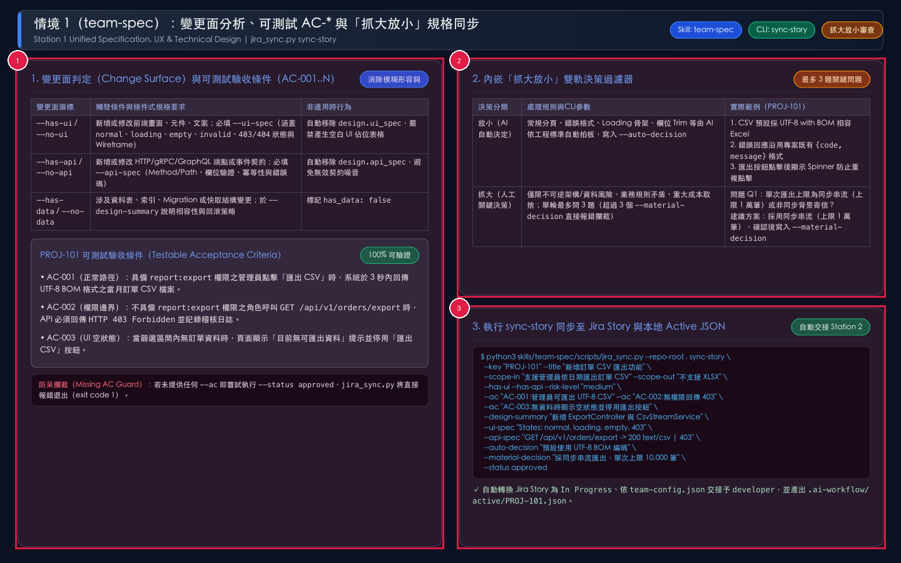
*圖 4-1：情境 1 執行 `team-spec`（`jira_sync.py sync-story`）之變更面判定、抓大放小雙軌審查與 Jira 同步實況圖。用途：說明如何在單一回合內產出可測試 `AC-001..003`、條件式 UI/API 規格，並透過「抓大放小」過濾器完成審查與 Jira 同步。視覺焦點：請依序查看標註序號 ① 左側變更面旗標（`--has-ui`、`--has-api`、`--has-data`）與 `AC-001..003` 可測試驗收條件；② 右上角內嵌「抓大放小」雙軌過濾器（AI 自動拍板之 `auto_decisions` vs 最多 3 題之 `material_decisions`）；③ 右下角執行 `sync-story --status approved` 同步至 Jira Story 與本地 `.ai-workflow/active/PROJ-101.json`。狀態變化：Story 規格由 `draft` 轉為 `approved`，Jira 狀態自動推進至 `In Progress`，並依角色配置自動交接予 `developer`。*

請依序執行以下四步驟完成 Station 1 規格定義與核准：

1. **步驟一：啟動 `$team-spec` 並提供需求描述與 Jira Story 代號**
   - 輸入提示詞：「請對 `PROJ-101`（新增訂單 CSV 匯出功能）執行 `$team-spec`。需求為支援管理員於訂單頁依日期區間匯出 CSV，無權限角色須攔截，無資料時按鈕停用。」
2. **步驟二：檢視 AI 產出的「抓大放小」規格摘要並回覆關鍵問題**
   - AI 呈現 Scope、`AC-001..003`、UI/API 設計、**AI 預設細節清單**（如預設採用 UTF-8 BOM 編碼、沿用標準錯誤格式）以及 **1 題關鍵人工決策問題**（例如：「單次匯出採同步串流上限 1 萬筆，或非同步背景寄信？建議方案：採同步串流上限 1 萬筆」）。
   - 使用者回覆：「同意建議方案，請核准並同步至 Jira。」
3. **步驟三：執行 `jira_sync.py sync-story --status approved` 寫入永久與暫存資產**

```bash
python3 skills/team-spec/scripts/jira_sync.py \
  --repo-root . sync-story \
  --key "PROJ-101" \
  --title "新增訂單 CSV 匯出功能" \
  --scope-in "支援管理員依日期區間匯出 UTF-8 BOM CSV" \
  --scope-out "本次不支援 XLSX 與排程自動寄信" \
  --has-ui --has-api --no-data \
  --risk-level "medium" \
  --ac "AC-001:管理員點擊匯出時 3 秒內回傳 UTF-8 CSV" \
  --ac "AC-002:無權限角色呼叫匯出 API 回傳 HTTP 403" \
  --ac "AC-003:無訂單資料時顯示空狀態並停用匯出按鈕" \
  --design-summary "新增 ExportController 與 CsvStreamService" \
  --ui-spec "States: normal, loading, empty, 403" \
  --api-spec "GET /api/v1/orders/export -> 200 | 403" \
  --auto-decision "CSV 預設附加 UTF-8 BOM 相容 Excel" \
  --auto-decision "錯誤回應沿用既有 {code, message} 格式" \
  --material-decision "Q1: 採同步串流匯出，上限 10,000 筆" \
  --status approved
```

4. **步驟四：確認自動交接結果**
   - 若 `pm` 與 `developer` 為同一人（例如 Alice 兼任），系統記錄 `handoff_mode: "auto-consolidated"` 並直接提示可執行 `$team-dev`（`plan` 模式）。
   - 若 `pm`（Alice）與 `developer`（Bob）為不同人，系統自動將 `PROJ-101` 轉為 `In Progress`、指派給 Bob 並發佈 `@Bob` 評論通知；同時提示 QA（Carol）可平行啟動 `$team-qa`（`plan` 模式）。

### 4.3 `jira_sync.py sync-story` 參數與防呆規格表

| 參數名稱 | 必填 / 類型 | 功能說明與輸入規範 | 內建防呆與狀態影響 |
| :--- | :--- | :--- | :--- |
| `--key` | **必填**（字串） | Jira Story 代號（如 `PROJ-101`） | 經 `validate_jira_key()` 嚴格檢查格式，阻斷 `..` 或 `/` 路徑遍歷攻擊 |
| `--title` | 選填（字串） | Story 標題摘要 | 同步至 Jira Story `summary` 與本地 JSON `title` |
| `--scope-in` / `--scope-out` | 選填（字串） | 明確定義本次包含範圍（In-Scope）與不包含範圍（Out-of-Scope） | 寫入 Jira Story 描述第 1 節與本地 JSON |
| `--has-ui` / `--no-ui` | 選填（布林旗標） | 標記是否包含前端畫面、元件或文案變更 | 當 `has_ui` 為 `false` 時，自動清除 `design.ui_spec` 防止殘留無效規格 |
| `--has-api` / `--no-api` | 選填（布林旗標） | 標記是否包含跨邊界 API 或事件契約變更 | 當 `has_api` 為 `false` 時，自動清除 `design.api_spec` |
| `--has-data` / `--no-data` | 選填（布林旗標） | 標記是否包含資料表、索引、Migration 或快取格式變更 | 記錄於 `change_surface.has_data` |
| `--risk-level` | 選填（列舉） | 風險等級：`low`、`medium`、`high`、`critical` | 預設為 `medium`，顯示於 Jira Story 規格標頭 |
| `--ac` | 可重複指定 | 可測試驗收條件，格式為 `AC-001:<description>`（即 `AC-001:` 加 **條件描述**，省略前綴則自動編號） | **增量 Upsert 與空白攔截**：於既有 `draft`/`approved` Story 上依 ID 增量更新或附加（不覆蓋舊 AC；若需整批重設可加 `--replace-acs`）；描述為空立即報錯 |
| `--design-summary` | 選填（字串） | 技術架構、影響模組、資料相容性與資安控制點摘要 | 寫入 `design.summary` |
| `--ui-spec` / `--api-spec` | 選填（字串） | 條件式 UI 狀態規格與 API 介面契約 | 僅在對應之 `--has-ui` / `--has-api` 為真時儲存與渲染 |
| `--auto-decision` | 可重複指定 | 「放小」：AI 依專案慣例自動決定的常規技術或 UX 細節 | 彙整於 Jira 描述第 4 節 **AI 預設細節清單**（跨輪次自動去重累加） |
| `--material-decision` | 可重複指定 | 「抓大」：經人類確認之關鍵架構或業務決策 | **大小需求雙軌防呆**：全新 Story 單趟直接 `approved` 上限 3 筆；多輪 `draft` 或 Station 2 Spec-Gap 補齊時每輪上限 5 筆且跨輪次自動無損累加 |
| `--spec-json` | 選填（JSON 字串或檔案） | 以整包 JSON 載入規格欄位 | 可與個別 CLI 旗標搭配使用（個別旗標優先覆寫） |
| `--status` | 選填（`draft` / `approved`） | 規格狀態；使用者確認後設為 `approved` | **未定 AC 禁止核准**：若設為 `approved` 但無任何 `AC-*`，立即報錯拒絕；核准後自動觸發 `pm -> developer` 交接 |
| `--approved-by` | 選填（字串） | 核准人姓名或角色 | 預設自動帶入 `team-config.json` 中之 `pm.name` |
| `--create` | 選填（布林旗標） | 在 Live Jira 模式下，若尚無此 Story 則呼叫 `POST /rest/api/3/issue` 新建 | 若建立成功，自動以遠端回傳之正式 Jira Key 更新本地檔名 |

---

## 5. 情境 2：任務拆解與 AI 編碼自動完工打卡（`team-dev`）

**Station 2（`team-dev`）** 負責將已核准的 Story 規格轉化為高品質程式碼與自動化測試。為了兼顧規劃清晰度與編碼專注度，`team-dev` 分為兩個明確模式：
- **模式一：`plan`（任務拆解與 Jira Sub-task 建立）**
- **模式二：`implement`（極簡上下文編碼、測試驗證與 `complete-task` 完工打卡）**

### 5.1 情境 2A（`team-dev` `plan` 模式）：垂直切片任務拆解與依賴檢查

當 `PROJ-101` 的 `spec_status` 已為 `approved`，且 `.ai-workflow/active/PROJ-101.json` 中的 `tasks` 尚為空陣列時，執行 `team-dev` 的 **`plan` 模式**。

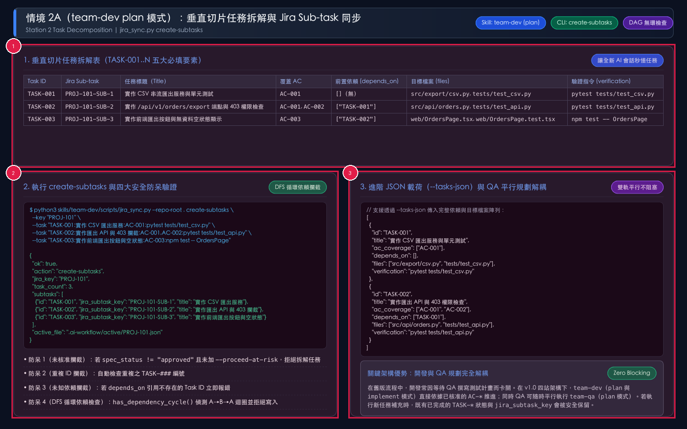
*圖 5-1：情境 2A 執行 `team-dev`（`plan` 模式 / `jira_sync.py create-subtasks`）之垂直切片任務表與安全防呆驗證圖。用途：將 `PROJ-101` 的 3 條 `AC-001..003` 拆解為具備明確驗證指令與依賴順序的 `TASK-001..003`，並同步建立 Jira `Sub-task`。視覺焦點：請依序查看標註序號 ① 頂部垂直切片任務拆解表（包含 Task ID、Jira Sub-task、覆蓋 AC、前置依賴 `depends_on`、目標檔案 `files` 與驗證指令 `verification`）；② 左下角執行 `create-subtasks` 輸出與四大安全防呆驗證（含 DFS 循環依賴攔截）；③ 右下角 `--tasks-json` 進階結構與 QA 平行規劃解耦說明。狀態變化：執行後 `PROJ-101.json` 寫入 3 筆 `status: "pending"` 之任務，並在 Jira 母單下建立 `PROJ-101-SUB-1..3` 子任務。*

在 `plan` 模式下，請依循以下三步驟操作：

1. **步驟一：讀取上游規格與專案目錄結構**
   - AI 讀取 `.ai-workflow/active/PROJ-101.json` 與 `docs/shared/engineering-standards.md`，盤點實際模組路徑與測試執行器（如 `pytest`、`npm test`）。
2. **步驟二：拆解為可獨立驗證的垂直切片（`TASK-001..N`）**
   - 每個任務都必須回答 5 個問題：(1) 改哪些檔案 (`files`)？(2) 滿足哪些驗收條件 (`ac_coverage`)？(3) 依賴哪些前置任務 (`depends_on`)？(4) 如何證明通過 (`verification`)？(5) 何時必須停機詢問人類？
3. **步驟三：執行 `jira_sync.py create-subtasks` 建立子任務**
   - 可使用簡潔的 `--task` 旗標，或使用 `--tasks-json` 傳入包含 `depends_on` 與 `files` 的完整陣列：

```bash
python3 skills/team-dev/scripts/jira_sync.py \
  --repo-root . create-subtasks \
  --key "PROJ-101" \
  --tasks-json '[
    {
      "id": "TASK-001",
      "title": "實作 CSV 串流匯出服務與單元測試",
      "ac_coverage": ["AC-001"],
      "depends_on": [],
      "files": ["src/export/csv.py", "tests/test_csv.py"],
      "verification": "pytest tests/test_csv.py"
    },
    {
      "id": "TASK-002",
      "title": "實作 /api/v1/orders/export 與 403 檢查",
      "ac_coverage": ["AC-001", "AC-002"],
      "depends_on": ["TASK-001"],
      "files": ["src/api/orders.py", "tests/test_api.py"],
      "verification": "pytest tests/test_api.py"
    },
    {
      "id": "TASK-003",
      "title": "實作前端匯出按鈕與無資料空狀態顯示",
      "ac_coverage": ["AC-003"],
      "depends_on": ["TASK-002"],
      "files": ["web/OrdersPage.tsx", "web/OrdersPage.test.tsx"],
      "verification": "npm test -- OrdersPage"
    }
  ]'
```

### 5.2 `jira_sync.py create-subtasks` 參數與防呆規格表

| 參數名稱 | 必填 / 類型 | 功能說明與輸入規範 | 內建防呆與狀態影響 |
| :--- | :--- | :--- | :--- |
| `--key` | **必填**（字串） | 母單 Jira Story 代號（如 `PROJ-101`） | 必須已存在 `.ai-workflow/active/<KEY>.json` |
| `--tasks-json` | 選填（JSON 字串或檔案） | 完整任務陣列（支援 `id`、`title`、`ac_coverage`、`depends_on`、`files`、`verification`） | 推薦用於包含前置依賴 `depends_on` 與目標檔案清單之任務拆解 |
| `--task` | 可重複指定 | 快速單行格式：`TASK-001:<Title>:AC-001,AC-002:<Verification>` | 可與 `--tasks-json` 併用；若省略 `TASK-###` 前綴則自動依序編號 |
| `--proceed-at-risk` | 選填（布林旗標） | 允許在 `spec_status != "approved"` 時強制先行拆解任務 | **預設安全防呆**：未加此旗標時，若規格未核准將直接報錯拒絕拆解 |
| **內建防呆** | 重複 ID 與未知依賴檢查 | 檢查 `planned_ids` 是否重複，以及 `depends_on` 是否引用不存在的 Task ID | 在呼叫遠端 Jira API 前先行驗證，避免建立半套孤兒 Sub-task |
| **內建防呆** | `has_dependency_cycle()` | 使用深度優先搜尋（DFS 三色標記法）檢查 `depends_on` 圖結構是否含有循環依賴 | 若偵測到 `TASK-001 -> TASK-002 -> TASK-001` 迴圈，立即報錯退出（exit code 1） |

### 5.3 情境 2B（`team-dev` `implement` 模式）：極簡上下文編碼與 `complete-task` 打卡

當子任務規劃完成（或出現待修復的 Open Bug）時，進入 `team-dev` 的 **`implement` 模式**。每完成一個子任務或 Bug 修復，**必須立即執行 `jira_sync.py complete-task` 打卡**，將 Git Commit SHA、修改檔案清單與真實測試結果寫入本地 Active JSON 並將對應的 Jira Sub-task 轉為 `Done`。

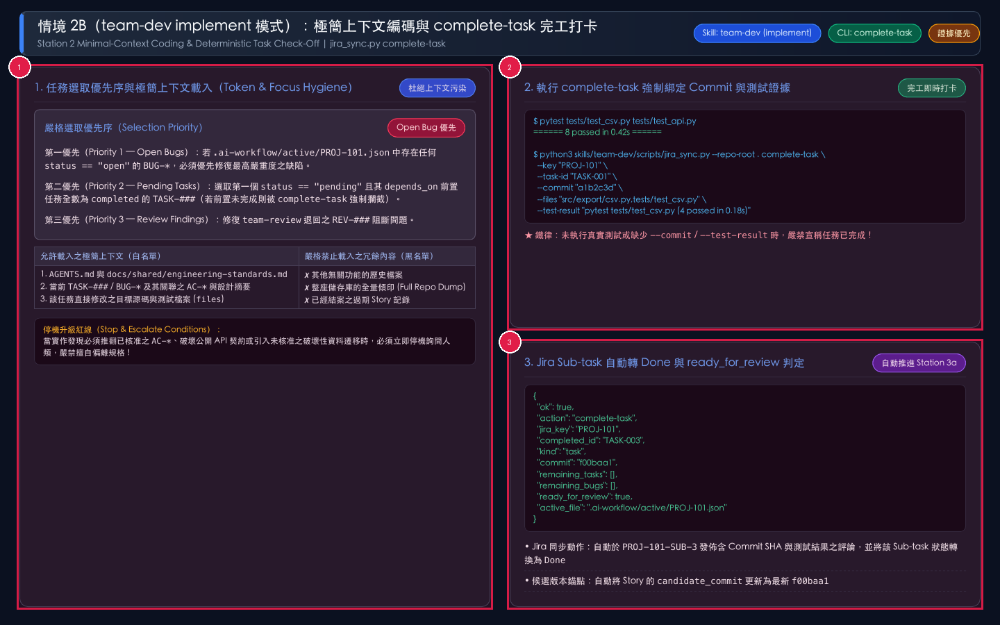
*圖 5-2：情境 2B 執行 `team-dev`（`implement` 模式 / `jira_sync.py complete-task`）之極簡上下文載入、測試驗證與完工打卡實況圖。用途：示範 AI 如何依優先序選取下一個待辦項目、僅載入必要的極簡上下文撰寫程式與測試，並透過 `complete-task` 同步完成狀態。視覺焦點：請依序查看標註序號 ① 左側任務選取優先序（Open Bugs > Pending Tasks > Review Findings）與極簡上下文白名單/黑名單；② 右上角執行真實測試並呼叫 `complete-task` 綁定 `--commit`、`--files`、`--test-result`；③ 右下角完成最後一個任務時 `ready_for_review` 自動轉為 `true` 並推進至 Station 3a。狀態變化：目標任務 `status` 轉為 `completed`、對應 Jira Sub-task 轉為 `Done`、Story 的 `candidate_commit` 更新為最新 Commit SHA。*

`implement` 模式的標準執行循環如下：

1. **步驟一：依嚴格三層優先序選取下一個可執行項目**
   - **第一優先（Open Bugs `BUG-*`）**：若 `bugs` 陣列中有 `status == "open"` 的缺陷，優先修復。
   - **第二優先（Pending Tasks `TASK-###` / 小型單任務快車道 Dev Fast-Track）**：選取第一個 `status == "pending"` 且其 `depends_on` 內所有前置任務皆已 `completed` 的 `TASK-###`。若為**小型 Story（`AC <= 3` 條且風險為 `low` 或 `medium`）**且尚未跑 `create-subtasks`（`tasks` 為空且 `spec_status == "approved"`），可直接執行 `complete-task --key <KEY> --task-id TASK-001`，系統將自動建立涵蓋全部 `AC-*` 的 `TASK-001` 並一次完成打卡！若為中大型或高風險需求（`AC > 3` 條或風險為 `high`/`critical`），**複雜度守衛（Complexity Guard）**會強制攔截快車道，要求必須先執行 `create-subtasks` 進行垂直切片拆解。
   - **第三優先（Open Review Findings `REV-###`）**：當 `review.status == "changes-requested"` 時，優先修復所有 `status == "open"` 之 `REV-###` 審查阻斷項。
2. **步驟二：極簡上下文載入（Minimal Context Loading）**
   - 僅讀取：(1) `AGENTS.md` 與 `docs/shared/engineering-standards.md`；(2) `.ai-workflow/active/PROJ-101.json` 中該任務關聯的 `AC-*` 與設計摘要（若跨機或跨 Git Worktree 本地無此檔案，系統會自動從主 Worktree 或遠端 Jira 無損回填）；(3) 該任務 `files` 指定的目標源碼與測試檔。
3. **步驟三：撰寫程式與自動化測試（含 `TC-###` 命名對齊）**
   - 若 QA 已平行完成 `team-qa`（`plan` 模式），在撰寫自動化測試案例時直接將 `TC-001`、`TC-002`（注意保留連字號 `TC-\d{3,}` 格式）寫入 JUnit XML 的 `name` 或 `classname`（例如 `test_export_csv_TC-001` 或 `TestExport/TC-001_valid`），以便後續 `record-qa --mode verify --junit-xml` 自動解析對應！
4. **步驟四：執行驗證測試並呼叫 `complete-task` 完工打卡（支援免填 `--commit` / `--files` 自動偵測與多 ID 批次打卡）**

```bash
python3 .ai-workflow/bin/jira_sync.py \
  --repo-root . complete-task \
  --key "PROJ-101" \
  --task-id "TASK-001" \
  --test-result "pytest tests/test_csv.py (4 passed in 0.18s)"
```

5. **步驟五：依序完成 `TASK-002` 與 `TASK-003`（或一次傳入 `--task-id TASK-002,TASK-003`）直至 `ready_for_review: true`**
   - 當輸出顯示 `"remaining_tasks": []`、`"remaining_bugs": []` 且 `"ready_for_review": true` 時，代表 Station 2 全部完成，立即引導進入 **Station 3a（`$team-review`）**。

### 5.4 `jira_sync.py complete-task` 參數與防呆規格表

| 參數名稱 | 必填 / 類型 | 功能說明與輸入規範 | 內建防呆與狀態影響 |
| :--- | :--- | :--- | :--- |
| `--key` | **必填**（字串） | Jira Story 代號（如 `PROJ-101`） | 更新對應之 `.ai-workflow/active/<KEY>.json`（缺失時自動從 Worktree 或 Jira 回填） |
| `--task-id` | 選填（預設 `TASK-001`，支援逗號多選） | 支援單一或逗號分隔之多個目標 ID：(1) 子任務 `TASK-001,TASK-002`；(2) 缺陷單 `PROJ-101-BUG-1`；(3) 審查問題 `REV-001,REV-002` | **Dev Fast-Track 與複雜度守衛**：僅限 `AC <= 3` 且 `low`/`medium` 風險之小型 Story 可自動建立 `TASK-001` 並打卡；大型或高風險 Story 強制要求先執行 `create-subtasks` |
| `--commit` | 選填（自動從 Git HEAD 偵測） | 實作該任務或修復該缺陷之 Git Commit SHA（如 `a1b2c3d`） | 未傳時自動執行 `git rev-parse --short HEAD` 取得，並更新 Story 之 `candidate_commit` |
| `--files` | 選填（自動從 Git Diff 偵測） | 以逗號分隔之實際修改檔案路徑清單 | 未傳時自動執行 `git show --name-only` / `git diff --name-only` 取得修改檔案清單 |
| `--test-result` | **必填**（字串） | 實際執行的測試指令與通過結果摘要 | **證據鐵律**：若未提供測試結果字串，拒絕標記為完成 |
| **內建防呆** | 前置依賴完成度檢查 | 當目標為 `TASK-###` 時，自動檢查其 `depends_on` 是否全數已在 `completed_ids` 集合中 | 若嘗試跳過前置任務（例如 `TASK-001` 未完成就打卡 `TASK-002`），直接報錯攔截 |
| **自動連動** | Review 退回狀態自動更新 | 當修復完所有 `blocker`/`major` 之 `REV-###` 審查問題後 | 若原 `review.status` 為 `changes-requested` 且已無開放之阻斷問題，自動轉為 `remediated` |

---

## 6. 情境 3：一人兼多職 vs 跨角色交接 Code Review（`team-review`）

### 6.1 觸發時機與情境背景

當 `PROJ-101` 的所有子任務（`TASK-001..003`）皆已完成且 `ready_for_review` 為 `true`（或者修復完 Bug / Review 退回問題使 `candidate_commit` 更新）時，進入 **Station 3a：`team-review`**。

`team-review` 將傳統的「開發交接文件（Dev Handoff）」與「程式碼審查（Code Review）」合而為一，針對 `candidate_commit` 的真實 Git Diff 執行**三軸「抓大放小」審查**，並依 `team-config.json` 執行多角色智慧交接。

### 6.2 操作步驟與視覺化實況詳解

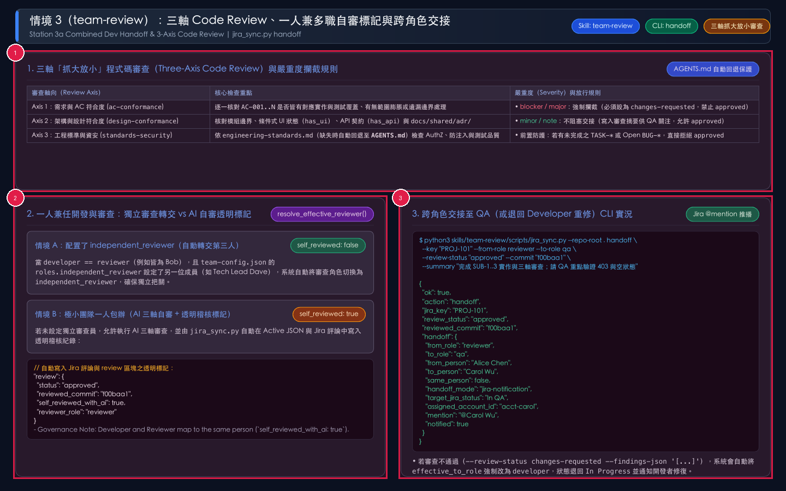
*圖 6-1：情境 3 執行 `team-review`（`jira_sync.py handoff`）之三軸審查矩陣、自審透明標記與跨角色 QA 交接實況圖。用途：說明如何從需求 AC、架構設計、工程標準三個軸向審查程式碼，以及如何處理一人兼任開發與審查、或跨人交接至 QA 的通知行為。視覺焦點：請依序查看標註序號 ① 頂部三軸「抓大放小」審查表與 `AGENTS.md` 自動回退保護機制；② 左下角一人兼任 `developer` 與 `reviewer` 時的兩種處理路徑（自動轉交 `independent_reviewer` vs 標記 `self_reviewed_with_ai: true`）；③ 右下角執行 `handoff` 將 `PROJ-101` 轉換為 `In QA`、指派給 Carol 並發送 `@Carol Wu` 評論。狀態變化：審查通過後 `review.status` 設為 `approved`、`review.reviewed_commit` 鎖定為 `f00baa1`，Story 進入 `In QA` 階段。*

請依序執行以下三步驟完成 Station 3a 審查與交接：

1. **步驟一：執行前置查核與三軸程式碼審查**
   - AI 代理執行 `git show <candidate_commit>` 實看程式碼變更，核對各 `TASK-*` 的 `changed_files` 與 `test_result`。
   - 載入 `docs/shared/engineering-standards.md`（**自動回退機制**：若該檔案不存在，自動回退讀取 `AGENTS.md` 並在審查報告註記 `standards_source: "AGENTS.md (fallback)"`，絕不讓小團隊因缺少檔案而卡死）。
   - 依三軸標準評估所有發現項（Findings）：
     - `blocker` / `major`：**必須攔截**（設為 `--review-status changes-requested` 退回 `developer`）。
     - `minor` / `note`：**不阻塞交接**（寫入摘要提醒 QA 注意，設為 `--review-status approved`）。
2. **步驟二：執行 `jira_sync.py handoff` 記錄審查結果並觸發交接**
   - **情況 A（審查通過，交接予 QA）**：

```bash
python3 skills/team-review/scripts/jira_sync.py \
  --repo-root . handoff \
  --key "PROJ-101" \
  --from-role reviewer \
  --to-role qa \
  --review-status "approved" \
  --commit "f00baa1" \
  --summary "完成 SUB-1..3 實作與三軸審查；AC-001..003 皆有測試覆蓋"
```

   - **情況 B（發現重大缺失，退回 Developer 重修）**：

```bash
python3 skills/team-review/scripts/jira_sync.py \
  --repo-root . handoff \
  --key "PROJ-101" \
  --from-role reviewer \
  --to-role qa \
  --review-status "changes-requested" \
  --commit "f00baa1" \
  --summary "AC-002 權限檢查缺失，未授權使用者仍可匯出" \
  --findings-json '[
    {
      "id": "REV-001",
      "severity": "major",
      "axis": "ac-conformance",
      "location": "src/api/orders.py:42",
      "ac_id": "AC-002",
      "observation": "缺少 report:export 權限驗證裝飾器",
      "status": "open"
    }
  ]'
```

3. **步驟三：確認多角色交接行為**
   - 若 `--review-status approved` 且 `reviewer`（Alice）與 `qa`（Carol）為不同人：Jira Story 自動轉為 `In QA`、指派給 Carol 並發佈 `@Carol Wu` 評論。
   - 若 `reviewer` 與 `qa` 為同一人：記錄 `handoff_mode: "auto-consolidated"`，直接提示進入 `$team-qa`。

### 6.3 `jira_sync.py handoff` 參數與防呆規格表

| 參數名稱 | 必填 / 預設值 | 功能說明與輸入規範 | 內建防呆與狀態影響 |
| :--- | :--- | :--- | :--- |
| `--key` | **必填**（字串） | Jira Story 代號（如 `PROJ-101`） | 載入並更新 `.ai-workflow/active/<KEY>.json` |
| `--from-role` | 選填（預設 `reviewer`） | 發起交接之角色 | 若 `developer == reviewer` 且已配置不同人之 `independent_reviewer`，自動升級為 `independent_reviewer` |
| `--to-role` | 選填（預設 `qa`） | 接收交接之目標角色 | 當 `--review-status changes-requested` 時，**強制覆寫為 `developer`** 並退回 `In Progress` |
| `--review-status` | 選填（預設 `approved`） | 審查結論：`approved` 或 `changes-requested` | **四大前置攔截**：若設為 `approved`，但 (1) `spec_status != approved`、(2) 有未完成之 `TASK-*`、(3) 有未關閉之 `BUG-*`、或 (4) `findings` 含開放之 `blocker`/`major`，立即報錯拒絕放行 |
| `--commit` | 選填（字串） | 本次審查對應之 Git Commit SHA（預設讀取 `candidate_commit`） | 儲存於 `review.reviewed_commit`，供後續發佈閘門比對是否發生 Commit 漂移 |
| `--summary` | 選填（字串） | 合併之「開發交接摘要 + 三軸審查結論」 | 同步發佈至 Jira Story 結構化評論 |
| `--findings-json` | 選填（JSON 字串或檔案） | 結構化審查問題陣列（含 `id`、`severity`、`axis`、`location`、`ac_id`、`observation`、`status`） | **自動產生 `REV-001` 防卡死**：若 `--review-status changes-requested` 未傳入阻斷項，系統自動依 `summary` 建立 `REV-001` 供開發者後續以 `complete-task --task-id REV-001` 標記完成 |
| `--target-status` | 選填（字串） | 手動指定 `status_mapping` 鍵值（如 `in_qa` 或 `ready_for_release`） | 未指定時自動依 `effective_to_role` 推導 |

---

## 7. 情境 4：QA 平行測試規劃與多源結果驗證（`team-qa`）

**Station 3b（`team-qa`）** 將傳統繁瑣的測試計畫、執行類型確認、證據收集與驗證報告收斂為兩個精煉模式，支援一次性選擇並記憶 **`jira-comment`（Jira 評論表格）** 或 **`qase`（Qase TestOps Suite / Case / Test Run 雙向連動）** 後端，並內建**三層混合測試模型（`automated` / `external` / `manual`）**與**防假通過守衛（Anti-False-Pass Guardrail）**：
- **模式一：`plan`（首次自動詢問並記憶 `jira-comment` 或 `qase` 後端 + 平行測試案例規劃 + AI 預填 `automated` / `external` / `manual` 三層執行類型）**
- **模式二：`verify`（依記憶之後端自動同步本機自動測試、外部工具報告與人工驗證結果 + Qase Test Run 自動結案 + 自動放行或開立 Bug 單）**

### 7.1 情境 4A（`team-qa` `plan` 模式）：平行測試規劃與 AI 預填類型一鍵確認

只要 `team-spec` 已核准（`spec_status == "approved"`），QA 即可隨時執行 `team-qa` 的 **`plan` 模式**（可與 `team-dev` 平行進行，或在 `team-review` 通過後執行）。

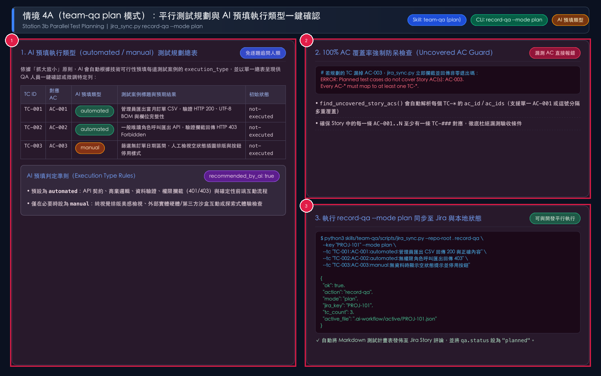
*圖 7-1：情境 4A 執行 `team-qa`（`plan` 模式 / `jira_sync.py record-qa --mode plan`）之 AI 預填測試總表與 100% AC 覆蓋檢查圖。用途：展示 AI 如何自動為每條 `AC-001..003` 規劃對應的 `TC-001..N` 並預填 `automated`、`external` 或 `manual` 執行類型，讓 QA 一鍵確認後同步至 Jira。視覺焦點：請依序查看標註序號 ① 左側 AI 預填執行類型的測試案例總表與判定準則；② 右上角 100% AC 覆蓋率強制防呆檢查（漏測任何 `AC-001..003` 立即報錯）；③ 右下角執行 `record-qa --mode plan` 輸出與 Jira 評論同步。狀態變化：執行後 `qa.status` 設為 `"planned"`，`qa.test_cases` 寫入 3 筆初始結果為 `"not-executed"` 之測試案例。*

`plan` 模式的標準操作步驟如下：

1. **步驟一：啟動 `$team-qa` `plan` 模式檢視 AI 預填三層測試總表**
   - AI 讀取 `PROJ-101.json` 中的 `AC-001..003` 與變更面旗標，自動產出涵蓋正常路徑、權限攔截（403）與 UI 空狀態的 `TC-001..003` 總表，並依技術特性預填三種執行類型：
     - `automated`：本機 AI 可直接執行的單元與整合測試（如 `pytest`、`vitest`）。
     - `external`：需依賴外部工具、CI/Staging 環境或第三方沙盒的測試（如 Playwright/Cypress E2E、Postman/Newman、JMeter）。
     - `manual`：需人工進行視覺體驗或探索式核對的測試。
   - QA 人員無須逐題回答，只需檢視總表並回覆「確認」（或指定修改某列類型）。
2. **步驟二：執行 `jira_sync.py record-qa --mode plan` 同步測試計畫**

```bash
python3 skills/team-qa/scripts/jira_sync.py \
  --repo-root . record-qa \
  --key "PROJ-101" \
  --mode plan \
  --tc "TC-001:AC-001:automated:管理員匯出 CSV 回傳 200 與 BOM" \
  --tc "TC-002:AC-002:automated:無權限角色呼叫匯出回傳 403" \
  --tc "TC-003:AC-003:manual:無訂單區間確認空狀態提示與按鈕停用"
```

### 7.2 情境 4B（`team-qa` `verify` 模式）：JUnit XML / JSON / CLI 多源結果驗證

當 `team-review` 審查通過（`review.status == "approved"`）且測試案例已規劃完成後，進入 `team-qa` 的 **`verify` 模式**。

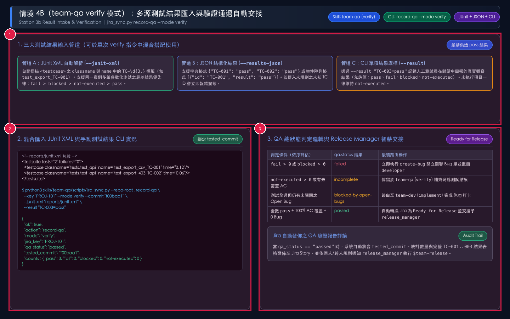
*圖 7-2：情境 4B 執行 `team-qa`（`verify` 模式 / `jira_sync.py record-qa --mode verify`）之多源結果匯入與驗證放行圖。用途：示範如何在單一指令中同時匯入 JUnit XML 自動化測試報告與 CLI 手動測試結果，並在全數通過時自動交接予 `release_manager`。視覺焦點：請依序查看標註序號 ① 頂部三大測試結果輸入管道（`--junit-xml`、`--results-json`、`--result`）與最差結果優先律；② 左下角混合匯入 `reports/junit.xml` 與 `--result "TC-003=pass"` 之終端機實況；③ 右下角 `qa.status` 四種判定結果與自動轉換 Jira 為 `Ready for Release`。狀態變化：當所有 `TC-001..003` 皆為 `pass` 且無 Open Bug 時，`qa.status` 轉為 `"passed"`、`qa.tested_commit` 鎖定為 `f00baa1`，並自動通知 `release_manager` 進行發佈。*

`verify` 模式的標準操作步驟如下：

1. **步驟一：執行自動化測試產生 JUnit XML 報告並收集手動測試結果**
   - 執行 `pytest --junitxml=reports/junit.xml` 取得含 `TC-001`、`TC-002` 標籤的測試報告。
   - 向 QA 測試員確認手動測試項目 `TC-003` 的實際觀察結果（例如 `pass`）。
2. **步驟二：執行 `jira_sync.py record-qa --mode verify` 匯入結果**

```bash
python3 skills/team-qa/scripts/jira_sync.py \
  --repo-root . record-qa \
  --key "PROJ-101" \
  --mode verify \
  --commit "f00baa1" \
  --junit-xml "reports/junit.xml" \
  --result "TC-003=pass"
```

3. **步驟三：依驗證結果分流處理**
   - 若輸出 `"qa_status": "passed"`：系統已自動將 AC/TC 驗證報表貼上 Jira Story、將狀態轉為 `Ready for Release` 並通知 `release_manager`，下一步即可執行 **`$team-release`**。
   - 若輸出 `"qa_status": "failed"`：請立即進入第 8 章（情境 5）執行 `create-bug` 啟動缺陷修復閉環！

### 7.3 `jira_sync.py record-qa` 參數與防呆規格表

| 參數名稱 | 適用模式 | 必填 / 類型 | 功能說明與輸入規範 | 內建防呆與狀態影響 |
| :--- | :--- | :--- | :--- | :--- |
| `--inspect` | 唯讀檢查 | 選填（布林旗標） | 檢查目前專案之 `qa_test_backend` 是否已設定（`requires_qa_backend_choice`）與 Qase 憑證狀態 | 不修改任何檔案；供 AI 在首次執行 `record-qa` 前詢問使用者要選用 `jira-comment` 或 `qase` |
| `--qa-backend` | `plan` & `verify` | 選填（`jira-comment` / `qase`） | 設定並記憶專案測試案例後端（寫入 `team-config.json` 之 `qa_test_backend`） | 設定一次後永久記憶，後續執行 `plan` 或 `verify` 自動沿用該後端 |
| `--qase-project-code` | `plan` & `verify` | 選填（字串） | 指定 Qase 專案代號（如 `AP`，預設可同 Jira `project_key`） | 寫入 `team-config.json` 之 `qase.project_code` |
| `--qase-token` | `plan` & `verify` | 選填（字串） | 設定 Qase API Token（`QASE_API_TOKEN`） | **只會寫入受 `.gitignore` 保護之 `.ai-workflow/credentials.json`（權限 `0600`）**，絕不寫入 `team-config.json` |
| `--key` | `plan` & `verify` | **必填**（字串） | Jira Story 代號（如 `PROJ-101`） | 讀寫 `.ai-workflow/active/<KEY>.json` 之 `qa` 區塊 |
| `--mode` | `plan` & `verify` | **必填**（列舉） | 指定執行模式：`plan` 或 `verify` | **QA Fast-Track**：`verify` 模式下若尚未執行過 `plan`（`test_cases` 為空），自動由 `AC-001..N` 1:1 衍生預設之 `TC-001..N` |
| `--tc` | `plan` | 可重複指定 | 單行測試案例格式：`TC-001:AC-001:<type>:<Title>`（`<type>` 支援 `automated`、`external` 或 `manual`，`<Title>` 為**標題與預期結果**，完整保留標題內所有冒號） | **100% AC 覆蓋防呆**：若規劃的所有 `TC-*` 未完整覆蓋 Story 的每一條 `AC-*`，立即報錯退出 |
| `--cases-json` | `plan` | 選填（JSON 字串或檔案） | 批次載入測試案例陣列（支援多重 AC 覆蓋 `ac_ids` 與 `notes`） | 自動標記 `"recommended_by_ai": true` 與初始結果 `"not-executed"` |
| `--junit-xml` | `verify` | 選填（檔案路徑） | 解析 JUnit XML 報告中 `classname` 或 `name` 含 `TC-\d{3,}` 之 `<testcase>` | 採**最差結果優先律**（`fail > blocked > not-executed > pass`），確保參數化測試任一失敗即標為 `fail` |
| `--results-json` | `verify` | 選填（JSON 字串或檔案） | 傳入 `{"TC-001": "pass"}` 字典或 `[{"id": "TC-001", "result": "pass"}]` 陣列 | **未知 TC 攔截**：若包含未規劃於 `qa.test_cases` 的 TC ID，立即報錯拒絕 |
| `--result` | `verify` | 可重複指定 | 單項結果格式：`TC-001=<status>[:<note>]` 或 `TC-001:<status>[:<note>]`（同時相容 `=` 與 `:` 分隔符及驗證備註，`<status>` 支援 `pass`、`fail`、`blocked`、`not-executed`） | 自動正規化 TC ID 大寫並將選用備註寫入 `notes`；若傳入非上述 4 種合法狀態值，立即報錯攔截 |
| `--all-pass` | `verify` | 選填（布林旗標） | **防假通過守衛（Anti-False-Pass）**：僅將尚未覆寫且 `execution_type == "automated"` 之本機自動化測試案例標記為 `pass` | `external`（外部工具/Staging）與 `manual`（人工測試）案例**絕不會**被 `--all-pass` 自動標為通過，必須透過 `--junit-xml`、`--results-json` 或 `--result` 提供真實結果，否則維持 `not-executed`（`qa_status: "incomplete"`） |
| `--commit` | `verify` | 選填（字串） | 本次測試驗證對應之 Git Commit SHA（預設讀取 `candidate_commit` 或 Git `HEAD`） | 記錄於 `qa.tested_commit`，作為 Station 4 發佈閘門對帳依據 |

---

## 8. 情境 5：發現缺陷自動開立 Jira Bug 單與修復重測閉環（`create-bug` 閉環）

### 8.1 觸發時機與情境背景

在真實工程實務中，QA 驗證常會發現預期外的缺陷。假設在對 `PROJ-101`（Commit `f00baa1`）執行 `team-qa` `verify` 模式時，發現 `TC-002`（對應 `AC-002` 無權限角色應回傳 `HTTP 403`）實際卻回傳 `HTTP 200` 並洩漏 CSV 資料！

此時嚴禁手動口頭通知或帶病發佈，必須透過 `jira_sync.py create-bug` 啟動**五步自動化缺陷修復與重測閉環**。

### 8.2 五步缺陷修復閉環與視覺化實況詳解

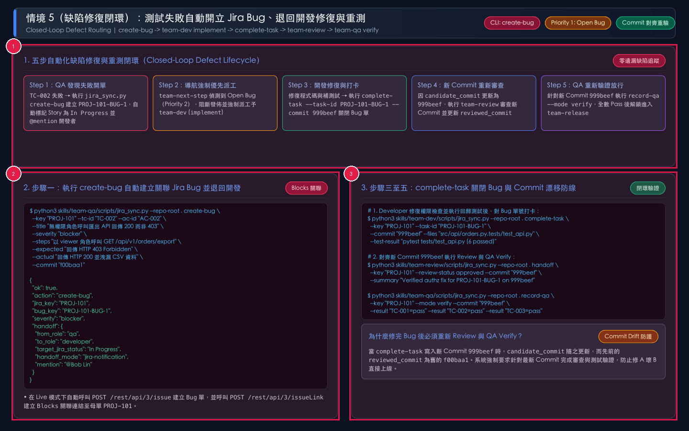
*圖 8-1：情境 5 測試失敗自動開立 Jira Bug 單、退回開發修復與重審重測完整閉環圖。用途：完整展示從 `TC-002` 測試失敗、`create-bug` 開單並退回 `In Progress`、開發者優先修復並以 `complete-task` 關單，到新 Commit `999beef` 重新通過 `team-review` 與 `team-qa verify` 的端到端閉環。視覺焦點：請依序查看標註序號 ① 頂部五步自動化缺陷閉環流程圖；② 左下角執行 `create-bug` 自動建立 `PROJ-101-BUG-1`（含 `Blocks` 關聯）並通知開發者 Bob；③ 右下角開發者執行 `complete-task --task-id PROJ-101-BUG-1 --commit 999beef` 後，對新 Commit 重新完成審查與驗證。狀態變化：Story 狀態經歷 `In QA` → `In Progress`（修 Bug）→ `In QA`（重審通過）→ `Ready for Release`（重驗通過），且 `candidate_commit`、`reviewed_commit`、`tested_commit` 三者重新對齊於 `999beef`。*

請依序執行以下五個步驟走完缺陷閉環：

1. **步驟一（QA 開單退回）：執行 `jira_sync.py create-bug` 建立關聯 Bug 單**

```bash
python3 skills/team-qa/scripts/jira_sync.py \
  --repo-root . create-bug \
  --key "PROJ-101" \
  --tc-id "TC-002" \
  --ac-id "AC-002" \
  --title "無權限角色呼叫匯出 API 回傳 200 而非 403" \
  --severity "blocker" \
  --steps "1. 以 viewer 登入 2. GET /api/v1/orders/export" \
  --expected "回傳 HTTP 403 Forbidden 且不回傳 CSV 內容" \
  --actual "回傳 HTTP 200 並下載完整訂單 CSV" \
  --attach "artifacts/tc-002-screenshot.png" \
  --commit "f00baa1"
```

   - 此指令會自動：(1) 在 Jira 建立 `Bug` 單（如 `PROJ-101-BUG-1`）、建立 `Blocks` 連結指向 `PROJ-101`，並將 `--attach`（或先前 `record-qa --tc-attach` 綁定）的截圖／錄影／Log 自動上傳掛載至 **Jira Bug 單附件區**（若 `qa_test_backend == "qase"`，亦同步上傳至 **Qase Test Run 結果與 Qase Defect**）；(2) 將 `TC-002` 標為 `fail` 且 `qa.status` 標為 `failed`；(3) 依 `TC-002 -> AC-002 -> TASK-###` 追蹤原實作開發者，將 Bug 單與 `PROJ-101` 指派給對應 `developer`（Bob）、狀態退回 `In Progress` 並發送繁體中文 `@Bob` 評論通知。
2. **步驟二（導航確認）：`team-next-step` 自動以最高優先級派工修 Bug**
   - 此時若執行 `jira_sync.py status --key PROJ-101`，導航員會因偵測到 Open Bug（Priority 2）而明確阻斷發佈，並指派 `team-dev`（`implement` 模式）優先修復 `PROJ-101-BUG-1`。
3. **步驟三（開發修復打卡）：在 `team-dev` (`implement`) 修復缺陷並執行 `complete-task`**
   - 開發者 Bob 補上路由權限檢查與回歸測試，提交新 Commit `999beef`，並對 Bug 單號打卡：

```bash
python3 skills/team-dev/scripts/jira_sync.py \
  --repo-root . complete-task \
  --key "PROJ-101" \
  --task-id "PROJ-101-BUG-1" \
  --commit "999beef" \
  --files "src/api/orders.py,tests/test_api.py" \
  --test-result "pytest tests/test_api.py (6 passed in 0.21s)"
```

   - 此動作會將 `PROJ-101-BUG-1` 標為 `completed`（在 Jira 轉為 `Done`），並將 `PROJ-101` 的 `candidate_commit` 更新為 `999beef`。
4. **步驟四（重新審查）：針對新 Commit `999beef` 執行 `team-review`**
   - 由於 `candidate_commit`（`999beef`）已與先前的 `reviewed_commit`（`f00baa1`）不同，導航員會自動要求執行 `team-review` 審查該修復 Commit：

```bash
python3 skills/team-review/scripts/jira_sync.py \
  --repo-root . handoff \
  --key "PROJ-101" \
  --from-role reviewer \
  --to-role qa \
  --review-status "approved" \
  --commit "999beef" \
  --summary "已確認 PROJ-101-BUG-1 權限攔截修復與回歸測試通過"
```

5. **步驟五（重新驗證）：針對新 Commit `999beef` 執行 `team-qa` (`verify`)**
   - QA 重新匯入測試結果並綁定 `--commit "999beef"`：

```bash
python3 skills/team-qa/scripts/jira_sync.py \
  --repo-root . record-qa \
  --key "PROJ-101" \
  --mode verify \
  --commit "999beef" \
  --result "TC-001=pass" \
  --result "TC-002=pass" \
  --result "TC-003=pass"
```

   - 此時 `qa.status` 轉為 `passed`、`tested_commit` 更新為 `999beef`、Open Bug 數為 `0`，正式解鎖進入 Station 4 發佈階段！

### 8.3 `jira_sync.py create-bug` 參數與防呆規格表

| 參數名稱 | 必填 / 預設值 | 功能說明與輸入規範 | 內建防呆與狀態影響 |
| :--- | :--- | :--- | :--- |
| `--key` | **必填**（字串） | 母單 Jira Story 代號（如 `PROJ-101`） | 將新建之 Bug 記錄寫入 `story.bugs` 陣列 |
| `--tc-id` | **必填**（字串） | 失敗之測試案例編號（如 `TC-002`） | 自動將 `qa.test_cases` 中對應之 `TC-002` 結果標為 `fail`，並將 `qa.status` 標為 `failed` |
| `--ac-id` | 選填（字串） | 受影響之驗收條件編號（如 `AC-002`） | 寫入 Bug 描述以維持 `BUG -> TC -> AC` 三層雙向追溯 |
| `--title` | **必填**（字串） | 簡明缺陷標題 | 在 Jira 建立標題為 `[<STORY-KEY>][<TC-ID>] <Title>` 之 `Bug` Issue |
| `--severity` | 選填（預設 `major`） | 嚴重度：`blocker`、`major`、`minor` | 記錄於 Bug 單描述與本地 JSON |
| `--steps` | **必填**（字串） | 具體重現步驟（Reproduction Steps） | 寫入 Jira Bug 描述之 `### Reproduction Steps` |
| `--expected` | **必填**（字串） | 預期正確行為（Expected Result） | 寫入 Jira Bug 描述之 `### Expected Result` |
| `--actual` | **必填**（字串） | 實際觀察到的錯誤行為（Actual Result） | 寫入 Jira Bug 描述之 `### Actual Result` |
| `--commit` | 選填（字串） | 發現缺陷時的受測 Commit SHA（預設讀取 `candidate_commit`） | 記錄於 `reported_commit`，並自動觸發 `qa -> developer` 退回交接（Story 轉為 `In Progress`） |

---

## 9. 情境 6：上線發佈與清除本地暫存鷹架（`team-release`）

### 9.1 觸發時機與情境背景

當 `PROJ-101` 完成所有開發子任務、通過三軸程式碼審查與 QA 測試驗證，且所有缺陷皆已修復關閉時，由發佈管理員（`release_manager`）執行 **Station 4：`team-release`**。

`team-release` 的核心使命是執行**五大發佈準備度閘門（5 Deterministic Release Gates）**與 **Commit SHA 三方對帳**，確認萬無一失後將最終發佈摘要寫入 Jira Story、將 Story 狀態轉為 `Done`，並**自動刪除本地暫存檔 `.ai-workflow/active/PROJ-101.json`**，確保 Git 儲存庫與工作區 100% 乾淨。

### 9.2 操作步驟與視覺化實況詳解

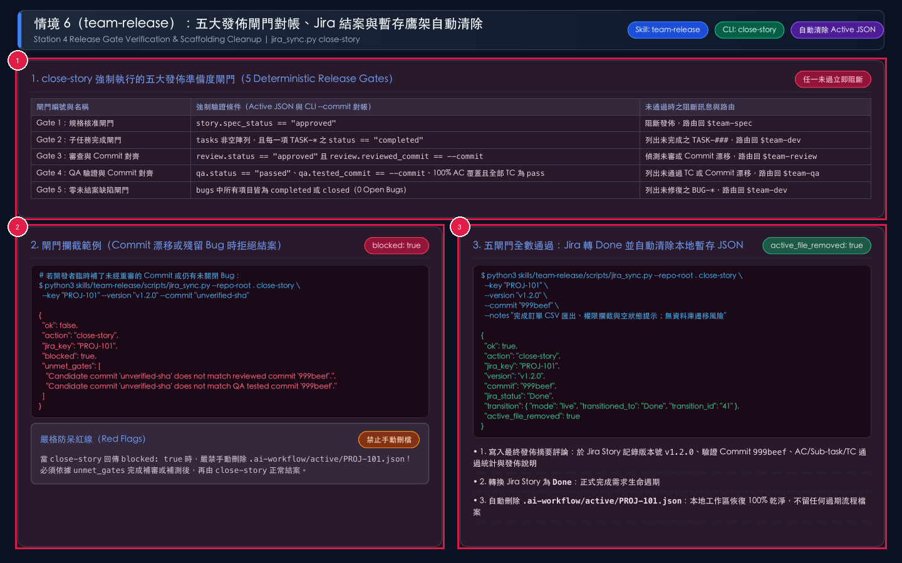
*圖 9-1：情境 6 執行 `team-release`（`jira_sync.py close-story`）之五大發佈閘門檢查、攔截範例與成功結案清除暫存檔實況圖。用途：展示 `close-story` 如何強制把關五大閘門與 Commit SHA 對齊，並在通過後自動將 Jira Story 轉為 `Done` 及刪除本地 Active JSON。視覺焦點：請依序查看標註序號 ① 頂部五大強制發佈準備度閘門規格表；② 左下角當 Commit 漂移或閘門未過時的 `blocked: true` 與 `unmet_gates` 攔截輸出；③ 右下角五閘門全數通過後將 Jira Story 轉為 `Done` 並回傳 `active_file_removed: true`。狀態變化：Jira Story 狀態由 `Ready for Release` 轉為最終態 `Done`，且 `.ai-workflow/active/PROJ-101.json` 從本地磁碟永久移除。*

請依序執行以下三步驟完成功能發佈與結案：

1. **步驟一：執行發佈前對帳檢查**
   - 確認五大閘門皆已滿足，且預計發佈之 `--commit`（如 `999beef`）與 `review.reviewed_commit` 及 `qa.tested_commit` 完全一致。
   - 若功能開發期間有更新全系統常駐活資產（`AGENTS.md`、`docs/shared/engineering-standards.md`、`docs/shared/glossary.md`、`docs/shared/adr/`），確認其已提交至 Git。
2. **步驟二：執行 `jira_sync.py close-story` 完成結案與暫存清除**

```bash
python3 skills/team-release/scripts/jira_sync.py \
  --repo-root . close-story \
  --key "PROJ-101" \
  --version "v1.2.0" \
  --commit "999beef" \
  --notes "完成訂單 CSV 匯出、403 攔截與空狀態提示；無遷移風險"
```

3. **步驟三：產出最終交付報告**
   - 向團隊回報 Jira Story `PROJ-101` 已轉為 `Done`、發佈版本號 `v1.2.0`、驗證通過之 Commit SHA `999beef`、累計驗證之 AC / Sub-task / TC 數量，並確認 `.ai-workflow/active/PROJ-101.json` 已自動清除。

### 9.3 `jira_sync.py close-story` 參數與五大發佈閘門規格表

| 類別 | 參數或閘門名稱 | 必填 / 驗證規則 | 失敗阻斷行為與狀態影響 |
| :--- | :--- | :--- | :--- |
| **CLI 旗標** | `--key` | **必填**（字串） | 目標 Jira Story 代號（如 `PROJ-101`） |
| **CLI 旗標** | `--version` | 選填（預設 `v1.0.0`） | 發佈版本號或 Git Tag（如 `v1.2.0`；未傳時自動預設為 `v1.0.0`） |
| **CLI 旗標** | `--commit` | 選填（自動讀取 `candidate_commit` 或 Git `HEAD`） | 預計發佈之候選 Git Commit SHA（如 `999beef`） |
| **CLI 旗標** | `--notes` | 選填（字串） | 發佈摘要說明（包含交付範圍、遷移/回滾說明與殘餘風險） |
| **Gate 1** | **規格核准閘門** | `story.spec_status == "approved"` | 若未核准，列入 `unmet_gates` 並拒絕結案（exit code 1） |
| **Gate 2** | **子任務完成閘門** | `tasks` 非空，且所有 `TASK-*` 之 `status == "completed"` | 若無子任務或有未完成子任務，列出未完成 ID 並阻斷結案 |
| **Gate 3** | **審查與 Commit 對齊閘門** | `review.status == "approved"` 且 `review.reviewed_commit == --commit` | 若未通過審查或 `--commit` 與審查 Commit 不一致，阻斷結案並要求重審 |
| **Gate 4** | **QA 驗證與 Commit 對齊閘門** | `qa.status == "passed"`、`qa.tested_commit == --commit`、100% AC 覆蓋且無非 `pass` 之 TC | 若未通過驗證、漏測 AC 或 `--commit` 與受測 Commit 不一致，阻斷結案 |
| **Gate 5** | **零開放缺陷閘門** | `bugs` 中無任何未完成（`status not in ("completed", "closed")`）之 Bug | 若仍有未關閉之 `BUG-*`，列出缺陷單號並阻斷結案 |

---

## 10. 情境 7：迷路、中斷或交接時隨時用導航員查詢下一步（`team-next-step`）

### 10.1 觸發時機與情境背景

在日常開發中，工程師常會遇到以下情境：
- 剛切換分支或接手同事的 Story，不確定目前停在哪一站？
- 同時進行多個 Story（如 `PROJ-101` 與 `PROJ-205`），想知道各自進度與阻斷點？
- 剛補了一個新的 Commit，不確定是否可以直接發佈還是需要重新 Review / QA？

此時只需呼叫唯讀導航員 **`$team-next-step`**（底層執行 `jira_sync.py status`），即可在不修改任何檔案與 Jira 狀態的前提下，獲得精確的下一步指令與負責人員建議。

### 10.2 11 級路由決策樹與雙模式架構實況詳解

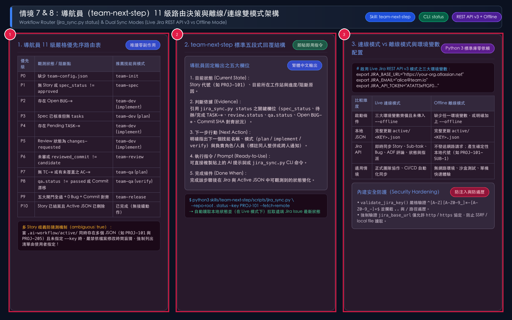
*圖 10-1：情境 7 導航員（`team-next-step` / `jira_sync.py status`）11 級優先序路由表、五段式回覆結構與情境 8 連線/離線雙模式架構圖。用途：說明 `team-next-step` 如何依 11 級嚴格優先序判斷唯一具體下一步，以及 `jira_sync.py` 如何在 Live Jira REST API v3 模式與 Offline 離線模式間自動切換。視覺焦點：請依序查看標註序號 ① 左側 P0 至 P10 共 11 級優先序路由決策表與多 Story 歧義防猜測機制；② 中間導航員固定輸出的五段式中文結構與 `status --fetch-remote` 指令；③ 右側 Live 連線模式（三大環境變數）與 Offline 離線模式對照表及安全防護機制。狀態變化：`status` 為純唯讀操作，不會變更任何本地 JSON 或遠端 Jira 狀態。*

導航員（`team-next-step`）的操作步驟如下：

1. **步驟一：執行 `jira_sync.py status` 檢查全局或指定 Story 狀態**

```bash
# 自動偵測當前進行中的 Story（若有多個則列出清單）
python3 skills/team-next-step/scripts/jira_sync.py \
  --repo-root . status

# 指定查詢特定 Jira Story，並於 Live 模式拉取遠端狀態
python3 skills/team-next-step/scripts/jira_sync.py \
  --repo-root . status \
  --key "PROJ-101" \
  --fetch-remote
```

2. **步驟二：檢視導航員固定輸出的五段式中文報告**
   - **1. 目前狀態 (Current State)**：Story 代號、目前所在工作站與進度/阻斷原因。
   - **2. 判斷依據 (Evidence)**：引用 `spec_status`、`tasks`、`review.status`、`qa.status`、`bugs` 與 Commit SHA 對齊證據。
   - **3. 下一步行動 (Next Action)**：推薦之技能名稱、模式與負責角色/人員（並標註屬於同人自動整併或跨人通知）。
   - **4. 執行指令 / Prompt (Ready-to-Use Input)**：可直接複製貼上的提示詞或 CLI 指令。
   - **5. 完成條件 (Done When)**：完成該步驟後在 Jira 與本地 JSON 的可觀測變化。

### 10.3 `jira_sync.py status` 參數與 11 級路由優先序規格表

| 優先級 / 參數 | 觀測狀態條件或參數用法 | 推薦技能 (`recommended_skill`) | 推薦模式 (`recommended_mode`) | 負責角色 (`responsible_role`) |
| :--- | :--- | :--- | :--- | :--- |
| **`--key`** | （選填參數）指定要查詢之 Jira Story 代號；若本地無 `<KEY>.json`，自動嘗試從主 Git Worktree 或遠端 Jira Issue 無損回填（Auto-Hydrate） | 依該 Story 狀態決定 | 依該 Story 狀態決定 | 依該 Story 狀態決定 |
| **`--fetch-remote`** | （選填旗標）在 Live 模式下呼叫 `GET /rest/api/3/issue/{key}` 取得遠端狀態並支援跨機自動回填 | 附加於 `remote_issue` 欄位 | — | — |
| **多工歧義防呆** | 未傳 `--key` 且 `.ai-workflow/active/` 下存在 `> 1` 個 JSON 檔案 | 回傳 `ambiguous: true` 與 `active_stories` 清單 | 嚴禁依檔案修改時間盲猜，強制請使用者選擇 | — |
| **Priority 0** | `.ai-workflow/team-config.json` 不存在 (`initialized: false`) | `team-init` | `null` | `tech_lead` / `pm` |
| **Priority 1** | 尚無 Active Story，或 `spec_status != "approved"` | `team-spec` | `null` | `pm` |
| **Priority 2** | 存在任何未關閉之缺陷（`bugs` 中 `status not in ("completed", "closed")`） | `team-dev` | `implement` | `developer` |
| **Priority 3** | `spec_status == "approved"`，但 `tasks` 為空陣列 `[]` | `team-dev`（附註 `team-qa` `plan` 可平行；自動輸出 `dev_fast_track_allowed` 標示是否允許快車道） | `plan` | `developer` |
| **Priority 4** | 存在未完成之子任務（`tasks` 中 `status != "completed"`） | `team-dev`（自動選出依賴已滿足之首個 `next_task_id`） | `implement` | `developer` |
| **Priority 5** | `review.status == "changes-requested"`（且有阻斷問題或尚未提交新 Commit） | `team-dev` | `implement` | `developer` |
| **Priority 6** | 子任務全完成，但 `review.status != "approved"` 或 `reviewed_commit != candidate_commit` | `team-review` | `null` | `reviewer` / `independent_reviewer` |
| **Priority 7** | Review 已通過，但 `qa.test_cases` 為空或有未覆蓋之 `AC-*` | `team-qa` | `plan` | `qa` |
| **Priority 8** | Review 已通過且 TC 已規劃，但 `qa.status != "passed"` 或 `tested_commit != candidate_commit` | `team-qa`（自動輸出 `pending_automated_tcs`、`pending_external_tcs`、`pending_manual_tcs` 待驗清單） | `verify` | `qa` |
| **Priority 9** | 五大閘門全數滿足、0 Open Bugs 且三個 Commit SHA 完全對齊 | `team-release` | `null` | `release_manager` |
| **Priority 10** | Jira Story 已轉為 `Done` 且本地 Active JSON 已刪除 | 無後續動作（已完成結案） | — | — |

---

## 11. 情境 8：離線模式 vs 真實 Jira REST API v3 連線模式與自我驗證

### 11.1 雙模式自動切換機制（Live Mode vs Offline Mode）

`scripts/jira_sync.py` 僅使用 Python 3 標準函式庫（零第三方套件依賴），內建 `JiraClient` 支援兩種執行模式：

1. **真實 Jira REST API v3 連線模式（Live Mode）**：
   - **啟動條件**：環境變數中同時具備 `JIRA_BASE_URL`（或已寫於 `team-config.json` 的 `jira_base_url`）、`JIRA_EMAIL` 與 `JIRA_API_TOKEN`，且執行 CLI 時未加上 `--offline` 旗標。
   - **配置方式**：在終端機或 CI/CD Secret 環境中設定：

```bash
export JIRA_BASE_URL="https://your-org.atlassian.net"
export JIRA_EMAIL="alice@team.io"
export JIRA_API_TOKEN="ATATT3xFfGF0..."
```

   - **執行行為**：所有對 `sync-story`、`create-subtasks`、`complete-task`、`handoff`、`record-qa`、`create-bug`、`close-story` 的呼叫，都會同步更新本地 `.ai-workflow/active/<JIRA-KEY>.json` 並透過 HTTP Basic Auth 呼叫 Jira Cloud REST API v3（自動將 Markdown 轉為 Atlassian Document Format `ADF v1`）。
2. **本地 / 離線模式（Offline Mode）**：
   - **啟動條件**：未設定上述環境變數，或在執行 `jira_sync.py` 時明確傳入全域旗標 `--offline`。
   - **執行行為**：100% 在本地確定性更新 `.ai-workflow/active/<JIRA-KEY>.json`，並為子任務與 Bug 產生確定性本地代號（如 `PROJ-101-SUB-1`、`PROJ-101-BUG-1`），非常適合無外網沙盒、單元測試與教育訓練演練。

### 11.2 Jira REST API v3 端點映射與維護自檢工具

下表列出 Live 模式下 `JiraClient` 實際呼叫之 REST API v3 端點與儲存庫內建的兩個自動化驗證工具：

| 類別 | 端點路徑或腳本名稱 | HTTP 方法 / 執行指令 | 觸發子命令與用途說明 | 認證與安全機制 |
| :--- | :--- | :--- | :--- | :--- |
| **Jira API** | `/rest/api/3/issue` | `POST` | `sync-story`（建立 `Story` 或 `PUT` 404 時自動 Fallback 建立）、`create-subtasks`（建立 `Sub-task`，400 時自動重試 `Subtask` / **子任務**）、`create-bug`（建立 `Bug`） | HTTP Basic Auth (`base64(email:token)`)；支援 ADF v1 `heading`、`bulletList`、`table` 富文本轉換 |
| **Jira API** | `/rest/api/3/issue/{key}` | `PUT` / `GET` | `sync-story`（更新 Story 標題與描述及 `[ai-workflow-state]` 狀態快照）、`status` 與跨機 `hydrate_story_from_remote` 自動回填 | URL Path 自動經 `urllib.parse.quote` 編碼 |
| **Jira API** | `/rest/api/3/issue/{key}/comment` | `POST` | 各工作站同步結構化評論；跨人交接時自動注入 ADF `mention` 節點 | 支援 `mention_account_id` 與 `mention_name` |
| **Jira API** | `/rest/api/3/issue/{key}/transitions` | `GET` + `POST` | 先查詢可用 Transition 清單，匹配目標狀態名稱（不分大小寫）後執行狀態轉換 | 若遠端工作流無對應狀態名稱，回傳 `warning` 不崩潰 |
| **Jira API** | `/rest/api/3/issue/{key}/assignee` | `PUT` | 跨角色交接時，將 Issue 指派給下一棒負責人的 `accountId` | 僅在 `to_person.jira_account_id` 非空時呼叫 |
| **Jira API** | `/rest/api/3/issueLink` | `POST` | `create-bug` 建立 `Blocks` 關聯，將新建之 `Bug`（inward）連結至母單 `Story`（outward） | 若連結權限受限則安全捕捉例外，不中斷退回開發流程 |
| **自檢工具** | `tools/check_shared.sh` | `bash tools/check_shared.sh` | 驗證全部 7 個技能目錄下的 `scripts/jira_sync.py` 與 `references/common-workflow-governance.md` 是否 100% SHA256 一致 | 任何一個技能副本發生漂移（Drift）立即回傳 exit code 1 |
| **測試套件** | `tools/test_workflow.py` | `python3 tools/test_workflow.py` | 執行端到端四站生命週期測試與本地 Mock Jira REST API v3 伺服器整合測試 | 涵蓋初始化、抓大放小防呆、循環依賴、Bug 閉環、Commit 漂移、跨機自動回填、快車道與 Live API 驗證 |

---

## 12. 常見問題、失敗場景與故障排查指南（Troubleshooting）

當團隊在操作過程中遇到 CLI 報錯或流程阻斷時，請對照下表依「症狀 → 根因 → 具體解決步驟」快速排除：

| 編號 | 常見錯誤訊息或異常症狀 | 根本原因（Root Cause） | 具體解決步驟（Resolution） |
| :--- | :--- | :--- | :--- |
| **T-01** | `ERROR: ... rule violated — at most 3 material questions/decisions are allowed.`（**抓大放小** 上限攔截） | 在執行 `sync-story` 時傳入了超過 3 個 `--material-decision`（或在 `--spec-json` 中 `material_decisions` 陣列長度大於 3）。 | 將常規工程/UX 細節移至 `--auto-decision`，僅保留真正涉及不可逆架構風險、業務矛盾或重大成本取捨的最多 3 項決策於 `--material-decision`。 |
| **T-02** | `ERROR: Cannot mark spec 'approved' without at least one testable AC (AC-001..N).` | 執行 `sync-story --status approved` 時未提供任何 `--ac`，或既有 Active JSON 中 `acceptance_criteria` 為空。 | 至少補充 1 條可測試之 `--ac "AC-001:..."` 後再執行 `--status approved`。 |
| **T-03** | `ERROR: Task dependency cycle detected in create-subtasks.` | `create-subtasks` 傳入之 `depends_on` 存在循環依賴（如 `TASK-001` 依賴 `TASK-002`，而 `TASK-002` 又依賴 `TASK-001`）。 | 檢查並修正 `--tasks-json` 中各任務的 `depends_on` 陣列，確保任務依賴關係為有向無環圖（DAG）。 |
| **T-04** | `ERROR: Cannot complete task 'TASK-002' before its dependencies are completed: TASK-001.` | 嘗試對 `TASK-002` 執行 `complete-task`，但其前置依賴任務 `TASK-001` 狀態仍為 `pending`。 | 先實作並驗證 `TASK-001`，執行 `complete-task --task-id TASK-001` 後，再打卡 `TASK-002`。 |
| **T-05** | `ERROR: Cannot set --review-status approved while open blocker/major findings exist.` | 執行 `handoff --review-status approved` 時，`--findings-json` 內仍包含 `severity` 為 `blocker` 或 `major` 且 `status` 為 `open` 的問題。 | 若確實存在重大問題，應改用 `--review-status changes-requested` 退回開發修復；若問題已修復，請將該 Finding 之 `status` 更新為 `completed`。 |
| **T-06** | `ERROR: Planned test cases do not cover Story AC(s): AC-003.` | 執行 `record-qa --mode plan` 時，所提供的 `TC-*` 案例未涵蓋 Story 中定義的所有 `AC-*`。 | 新增對應 `AC-003` 的測試案例（例如 `--tc "TC-003:AC-003:automated:..."`），確保 100% AC 覆蓋率。 |
| **T-07** | `close-story` 報錯 `blocked: true`，且 `unmet_gates` 顯示 `Candidate commit 'X' does not match reviewed commit 'Y'` | 在 `team-review` 或 `team-qa` 通過後，開發者又提交了新的 Commit（或修復了 Bug 更新了 `candidate_commit`），導致 Commit 漂移。 | **嚴禁手動刪除 Active JSON**！請依 `team-next-step` 指引，針對最新 Commit `X` 重新執行 `team-review`（`handoff --commit X`）與 `team-qa`（`record-qa --mode verify --commit X`），對齊後再執行 `close-story`。 |
| **T-08** | `status` 回傳 `"ambiguous": true` 與多個 Story 代號（如 `PROJ-101, PROJ-205`） | `.ai-workflow/active/` 目錄下同時有多個進行中的功能，且呼叫 `status` 時未指定 `--key`。 | 詢問使用者本次要操作哪一個 Jira Story，並在指令加上 `--key PROJ-101`。 |
| **T-09** | `Jira API POST /rest/api/3/... failed with HTTP 401 / 403` | 環境變數 `JIRA_EMAIL` 或 `JIRA_API_TOKEN` 錯誤、過期，或該帳號無目標 Jira 專案權限。 | 於 Atlassian 帳號設定重新產生 API Token 並更新環境變數；若暫時無須連線 Jira，可加上 `--offline` 旗標切換為離線模式繼續工作。 |

---

## 13. 附錄

### 13.1 附錄 A：全系統技能、CLI 子命令與狀態轉換完整對帳表

本表彙整 `scripts/jira_sync.py` 全部 2 個全域旗標與 11 個子命令之完整語法對帳（預設語言 `"language": "zh-TW"`，所有 Jira 評論、Story/Sub-task/Bug 描述預設皆以繁體中文輸出，技術代號維持標準 ASCII）：

| 子命令 / 層級 | 對應技能與工作站 | 完整支援旗標清單 | 核心讀取檔案 | 核心寫入 / 更新標的 |
| :--- | :--- | :--- | :--- | :--- |
| **Global 全域旗標** | 全部 7 個技能 | `--repo-root <PATH>`（預設 `.`）、`--offline`（強制離線模式） | 環境變數或 `.ai-workflow/credentials.json` | 控制工作目錄與 `JiraClient` 連線/離線模式 |
| `init` | `team-init` (Init) | `--inspect`, `--auth-only`, `--role`, `--specialty`, `--language`, `--name`, `--project-key`, `--jira-url`, `--jira-email`, `--jira-token`, `--roles-json`, `--role-tokens-json`, `--status-mapping-json`, `--issue-type-mapping-json`, `--qa-backend`, `--qase-*`, `--agents-md`, `--standards-md` | 既有 `AGENTS.md`、既有 `.gitignore` 與 `team-config.json` | `.ai-workflow/team-config.json`（含 1 對多角色池 `members` 與預設 `zh-TW`）、`credentials.json`、`.ai-workflow/bin/jira_sync.py`、`.gitignore`、`docs/shared/engineering-standards.md`、`AGENTS.md` |
| `auth` | `team-init` (`auth` 協作者認領) | `--inspect`, `-i`, `--role`, `--specialty`, `--replace-role`, `--name`, `--jira-email`, `--jira-token`, `--role-tokens-json`, `--qase-token` | `team-config.json`, `credentials.json` | 將協作者非破壞性追加至 `team-config.json` 角色池（`members`），並將個人 Token 安全寫入本機 `credentials.json` (`member_credentials`) |
| `status` | `team-next-step` (Router) | `--key`, `--fetch-remote` | `team-config.json`, `.ai-workflow/active/*.json`, `engineering-standards.md` | 自動與遠端 Jira 雙向對帳（含新建 Story 探索、人工新增/改狀態之 Sub-task 與 Bug 同步）並推薦下一步 |
| `pull` | `team-next-step` (雙向對帳) | `--key` | `team-config.json`, `active/*.json`, 遠端 Jira Issues | 主動拉取並融合 Jira 網頁端人工新增/修改之 Story、Sub-task、連結 Bug、Assignee 與描述 `AC-###`（含描述覆寫防護 `remote_description_modified`） |
| `sync-story` | `team-spec` (Station 1) | `--key`, `--title`, `--scope-in`, `--scope-out`, `--has-ui`, `--no-ui`, `--has-api`, `--no-api`, `--has-data`, `--no-data`, `--risk-level`, `--ac`, `--replace-acs`, `--design-summary`, `--ui-spec`, `--api-spec`, `--auto-decision`, `--material-decision`, `--spec-json`, `--status`, `--approved-by`, `--to-assignee`, `--accept-remote-description`, `--force-overwrite`, `--create` | `team-config.json`, 既有 `active/<KEY>.json` | `.ai-workflow/active/<KEY>.json`, Jira `Story`（`draft` 自動指派 `pm`、`approved` 自動交接指派 `developer`，並保護網頁端人工描述變更） |
| `create-subtasks` | `team-dev` (`plan`, Station 2) | `--key`, `--tasks-json`, `--task`, `--assignee`, `--task-assignee`, `--proceed-at-risk` | `team-config.json`, `active/<KEY>.json` | `.ai-workflow/active/<KEY>.json` (`tasks`), 建立 Jira `Sub-task` 並依專長/指定自動指派各子任務經辦人（Assignee） |
| `complete-task` | `team-dev` (`implement`, Station 2) | `--key`, `--task-id`, `--commit`, `--files`, `--test-result` | `team-config.json`, `active/<KEY>.json` | `.ai-workflow/active/<KEY>.json`（支援多 ID、Dev Fast-Track 自動指派、Git 自動偵測）, Jira `Sub-task`/`Bug` 繁體中文打卡並轉 `Done` |
| `handoff` | `team-review` (Station 3a) | `--key`, `--from-role`, `--to-role`, `--to-assignee`, `--review-status`, `--commit`, `--summary`, `--findings-json`, `--target-status` | `team-config.json`, `active/<KEY>.json` | `.ai-workflow/active/<KEY>.json`（多人 `reviewer` 自動避開作者選取同儕審查）, Jira 狀態轉換、Assignee 指派與繁體中文 `@mention` 評論 |
| `record-qa` | `team-qa` (`plan`/`verify`, Station 3b) | `--inspect`, `--key`, `--mode`, `--qa-owner`, `--to-assignee`, `--qa-backend`, `--qase-*`, `--cases-json`, `--tc`, `--junit-xml`, `--results-json`, `--result`, `--all-pass`, `--commit` | `team-config.json`, `active/<KEY>.json`, JUnit XML / JSON 報告 | `.ai-workflow/active/<KEY>.json` (`qa`, `handoffs`), Jira 繁體中文測試計畫評論 / Qase 同步與 `Ready for Release` 交接 |
| `create-bug` | `team-qa` (`verify`, Station 3b) | `--key`, `--tc-id`, `--ac-id`, `--to-assignee`, `--title`, `--severity`, `--steps`, `--expected`, `--actual`, `--commit` | `team-config.json`, `active/<KEY>.json` | `.ai-workflow/active/<KEY>.json` (`bugs`), Jira 新建 `Bug`、自動追溯指派給負責該模組之 `developer`、建立 `Blocks` 關聯並退回修復 |
| `close-story` | `team-release` (Station 4) | `--key`, `--version`, `--commit`, `--notes` | `team-config.json`, `active/<KEY>.json` | 先執行 Jira 雙向對帳再驗證五大發佈閘門、發佈繁體中文結案摘要、將 Jira `Story` 轉為 `Done`、**刪除 `.ai-workflow/active/<KEY>.json`** |

### 13.2 附錄 B：視覺圖表與截圖資產驗收清單

本手冊共包含 12 張高解析度（`1440x900`）標註視覺圖表，皆存放於 `docs/screenshots/`，並已通過多模態視覺實看驗收、檔案大小檢查（皆 `> 270 KB`）與 SHA256 唯一性檢查：

| 圖表編號 | 檔案名稱 (`docs/screenshots/`) | 對應章節與情境 | 標註框數量 (`--box`) | 驗證狀態（多模態實看 & SHA256 唯一） |
| :--- | :--- | :--- | :--- | :--- |
| **圖 2-1** | `01-architecture-asset-boundary.png` | 2.1 四站七技能全景架構與資產邊界 | ① ② ③（3 處紅框徽章） | 已通過視覺驗收（無破版、無亂碼） |
| **圖 2-2** | `02-state-machine-and-roles.png` | 2.2 Jira 狀態轉換機與多角色智慧交接 | ① ② ③（3 處紅框徽章） | 已通過視覺驗收（無破版、無亂碼） |
| **圖 3-1** | `03-scenario0-team-init.png` | 第 3 章 情境 0：`team-init` 專案初始化 | ① ② ③（3 處紅框徽章） | 已通過視覺驗收（無破版、無亂碼） |
| **圖 4-1** | `04-scenario1-team-spec.png` | 第 4 章 情境 1：`team-spec` 規格與抓大放小 | ① ② ③（3 處紅框徽章） | 已通過視覺驗收（無破版、無亂碼） |
| **圖 5-1** | `05-scenario2-team-dev-plan.png` | 5.1 情境 2A：`team-dev` (`plan` 模式) | ① ② ③（3 處紅框徽章） | 已通過視覺驗收（無破版、無亂碼） |
| **圖 5-2** | `06-scenario2-team-dev-implement.png` | 5.3 情境 2B：`team-dev` (`implement` 模式) | ① ② ③（3 處紅框徽章） | 已通過視覺驗收（無破版、無亂碼） |
| **圖 6-1** | `07-scenario3-team-review.png` | 第 6 章 情境 3：`team-review` 三軸審查與交接 | ① ② ③（3 處紅框徽章） | 已通過視覺驗收（無破版、無亂碼） |
| **圖 7-1** | `08-scenario4-team-qa-plan.png` | 7.1 情境 4A：`team-qa` (`plan` 模式) | ① ② ③（3 處紅框徽章） | 已通過視覺驗收（無破版、無亂碼） |
| **圖 7-2** | `09-scenario4-team-qa-verify.png` | 7.2 情境 4B：`team-qa` (`verify` 模式) | ① ② ③（3 處紅框徽章） | 已通過視覺驗收（無破版、無亂碼） |
| **圖 8-1** | `10-scenario5-bug-loop.png` | 第 8 章 情境 5：`create-bug` 缺陷修復閉環 | ① ② ③（3 處紅框徽章） | 已通過視覺驗收（無破版、無亂碼） |
| **圖 9-1** | `11-scenario6-team-release.png` | 第 9 章 情境 6：`team-release` 發佈與清除暫存 | ① ② ③（3 處紅框徽章） | 已通過視覺驗收（無破版、無亂碼） |
| **圖 10-1** | `12-scenario7-and-8-router-and-modes.png` | 第 10 & 11 章 情境 7 & 8：導航員與雙模式 | ① ② ③（3 處紅框徽章） | 已通過視覺驗收（無破版、無亂碼） |

### 13.3 附錄 C：核心術語表（Glossary）

| 術語名稱 | 英文對照 / 識別碼 | 定義說明 |
| :--- | :--- | :--- |
| **第一性原理資產邊界** | First-Principles Asset Boundary | 將單一功能生命週期資產（歸屬 Jira + 本地暫存 Active JSON）與全系統常駐活資產（歸屬 Git）嚴格分離之架構原則。 |
| **抓大放小** | Focus on Material Risks, Auto-Default Minor Details | AI 自動依工程標準決定常規細節並列出 `auto_decisions` 清單，僅針對不可逆架構風險、業務矛盾或重大成本取捨提出最多 3 題 `material_decisions` 問題。 |
| **本地暫存鷹架** | `.ai-workflow/active/<JIRA-KEY>.json` | 開發期間存放於本地且被 `.gitignore` 忽略之機器可讀狀態檔，於 `close-story` 結案時自動刪除。 |
| **同人自動整併** | `auto-consolidated` | 當相鄰兩工作站負責人為同一人時，自動省略自我 `@mention` 通知與重設 Assignee 的無摩擦交接模式。 |
| **跨人通知交接** | `jira-notification` | 當相鄰兩工作站負責人為不同人時，自動轉換 Jira 狀態、重新指派 Assignee 並發佈含 `@mention` 評論之交接模式。 |
| **AI 自審透明標記** | `self_reviewed_with_ai: true` | 當 `developer` 與 `reviewer` 為同一人且未配置獨立審查員時，在審查紀錄與 Jira 評論中自動揭露由 AI 輔助完成三軸自審之稽核標記。 |
| **候選版本錨點** | `candidate_commit` | 開發者透過 `complete-task` 最新打卡之 Git Commit SHA；發佈前必須與 `review.reviewed_commit` 及 `qa.tested_commit` 完全一致。 |
| **最差結果優先律** | Worst-Outcome Precedence | `parse_junit_xml_results()` 解析同一 `TC-###` 多筆測試結果時，依 `fail > blocked > not-executed > pass` 決定最終結果之安全規則。 |

### 13.4 交付前品質檢查清單（Quality Checklist）

- [x] **源碼 100% 對帳**：三層盤點表中的所有 7 個技能、9 個 `jira_sync.py` 子命令、所有 CLI 旗標、角色設定與五大發佈閘門皆已在正文中完整說明，無任何遺漏模組。
- [x] **零空殼章節（Zero Image-Only Stubs）**：每一個含圖片的章節皆具備結構化參數規格表與具體操作步驟清單。
- [x] **視覺圖表 100% 多模態驗收**：已使用讀圖工具逐張檢視全部 12 張 `.png` 圖表，確認排版清晰、繁體中文顯示正確、紅框與編號徽章（① ② ③）精準對齊。
- [x] **圖說三要素齊全**：每張圖下方皆完整包含「用途、視覺焦點（對應標註序號 ① ② ③）、狀態變化」。
- [x] **PDF 導出零警告通過**：全文無任何 emoji、無中文反引號 code span、程式碼區塊單行視覺寬度皆 `<= 68` 欄，且通過 `render_manual.py --fail-on-warning` 零警告檢驗。
