# Wireframes Template

Use this layout for `docs/ux/<feature-slug>/wireframes.md`. It provides concrete visual, structural, and situation specifications for each screen in the package.

```markdown
---
artifact_id: UX-WIRE-<feature-slug>
artifact_type: wireframes
feature: <feature-slug>
artifact_status: draft
validity: current
owner_role: UI/UX
---

# <Feature> — Wireframe Specifications

## 1. Information Architecture and Navigation Flow

```mermaid
graph TD
  S01["S01: Entry Screen"] -->|Action Submit| S02["S02: Confirmation Modal"]
  S01 -->|Error / Timeout| S01_Err["S01 (Situation: offline/error)"]
```


---

## 2. Screen Specifications

### S01: `<Screen Name>`
- **Upstream Traceability:** REQ-001, AC-001
- **Figma Reference (if applicable):** `[Figma Frame URL]` or Frame ID `#frame-101`

#### 2.1 Layout & Hierarchy (ASCII / Markdown representation)
```text
+-------------------------------------------------------------------+
|  [Header / Brand]                          [User Profile / Avatar]|
+-------------------------------------------------------------------+
|                                                                   |
|  Page Title: Manage Cards                                         |
|  [+ Add New Card (Primary Button)]                                |
|                                                                   |
|  +-------------------------------------------------------------+  |
|  | Search cards... [input]          Filter: [All v] [Sort: Date]|  |
|  +-------------------------------------------------------------+  |
|                                                                   |
|  +-----------------------+ +-----------------------+              |
|  | Card #1               | | Card #2               |              |
|  | Title: Marketing      | | Title: Engineering    |              |
|  | [Edit] [Delete]       | | [Edit] [Delete]       |              |
|  +-----------------------+ +-----------------------+              |
|                                                                   |
+-------------------------------------------------------------------+
```

#### 2.2 Situation States
Every screen must define how it behaves across canonical situation states:
- **Normal (Default):** Cards displayed in grid; search input empty.
- **Loading:** Skeleton placeholder blocks matching grid dimensions (no spinner overlay).
- **Invalid / Validation:** Search query returns 0 matching results ("No matching cards found").
- **403 (Unauthorized):** Banner message indicating insufficient permissions to view cards.
- **404 (Not Found):** N/A or resource missing view.
- **Empty (Zero Data):** Illustrated card placeholder with call-to-action button "Create your first card".
- **Offline / Network Failure:** Non-blocking toast notification "Network offline; showing cached cards".

#### 2.3 Micro-interactions and Focus Order
- **Tab navigation order:** Search Input -> Filter Select -> Sort Select -> Add Button -> Card items.
- **Hover/Active states:** Card elevates shadow on hover; primary button shifts brightness by 10%.
```
